# 위성통신 AI 항재밍 채널 도약 시뮬레이션 (RF → STFT → CNN → DQN)

재밍 신호를 CNN으로 탐지하고, 그 탐지 결과(채널별 재밍 확률)만을 관측으로 삼아 강화학습(DQN)이 통신 채널을 고르는 항재밍 파이프라인의 시뮬레이션입니다. 재머의 위치(정답)는 보상 계산에만 쓰이고 에이전트의 관측으로 새지 않도록 설계했습니다.

> 공개된 일반 이론과 합성 신호만 사용한 학습용 시뮬레이션이며, 특정 무기체계나 실제 운용 정보와 무관합니다.

## 1. 한눈에 보기

- 4종 재머(단일톤, 스윕, 광대역 잡음, 부분대역 잡음)를 STFT 스펙트로그램 기반 2D-CNN으로 분류: 테스트 정확도 **99.0%** (SNR 0~20 dB, J/S 0~15 dB 범위, 합성 데이터)
- CNN 관측 기반 DQN 채널 도약: 재머 4개가 동시에 공격하는 32채널 환경에서 통신 성공률 **96.5%** (시드 5개 평균, 표준편차 0.3, 랜덤 호핑 88.3%, 이론 상한 97.5%)
- 표 기반 Q-learning을 30000 에피소드까지 학습시켜도 94.3%에 머무름 (DQN은 800 에피소드). 약 38배 적은 학습으로 더 높은 성공률이며, 5개 시드 모두에서 DQN이 표 기반보다 높음
- 관측 지연 0~4슬롯(위성 전파 지연 모사)에서 DQN은 이론 상한보다 1.1~1.2%p 아래를 일정하게 유지하고, 30000 에피소드 학습한 표 기반보다 0.8~2.2%p 높음 (시드 5)
- 이론 상한식이 근사가 아니라 정확한 값임을 베이즈 최적 정책의 몬테카를로로 검증 (7개 재머 모델, 표준오차 1~2배 이내 일치)
- 재머 종류에 따라 최적 기법이 달라짐: 정적 재머에서는 학습 없는 센싱 회피와 AFH가 상한(99.8%)에 도달해 DQN(98.0%)보다 높고, FHSS는 패턴이 유출되면 9.8%로 무너짐
- BPSK BER 시뮬레이터를 이론식 Q(√(2Eb/N0))와 대조해 검증
- 도플러, 링크 SNR, Rician 페이딩을 넣은 LEO 위성 채널(가정값)에서 CNN 탐지를 앙각별로 평가: 앙각 10도에서 오탐 18%로 증가, 채널 증강 재학습으로 11%까지 감소
- 위성 한 번 통과(LEO 550 km, 약 8분) 전체를 채널 → CNN → DQN으로 연결: 시간 가중 통신 성공률 **95.8%** (정답 관측 DQN 96.5%, 표 기반 93.7%, 랜덤 88.3%). 손실은 대부분 앙각 20도 이하에 몰림. 채널 증강 CNN은 저앙각 오탐을 절반으로 줄였지만 통과 전체로는 +0.2%p
- 재머 종류에 맞는 대응(도약, 간섭 제거, 확산, 부호화)을 고르는 링크 수준 실험: CNN 분류 + 수신 전력 추정은 종류를 완벽히 아는 경우와 같은 성능(종합 처리량 0.891 대 0.892). 빈 채널을 찾기 어려운 조건에서 항상 도약하는 방식보다 처리량이 절반으로 떨어지는 J/S를 6.5 dB 이상 높임
- 우리 대응을 보고 바꾸는 적응형 재머와의 반복 게임: 한 슬롯 늦게 반응하는 결정적 조회표는 재머 전력이 클 때 공략당해(최악 0.527, 게임 이론 보장값 0.657) 무작위화(최소최대 혼합 전략)나 온라인 학습(Hedge)이 필요. 같은 슬롯 안에 반응하면 보장값보다 높은 0.738
- 공개 실측 IQ 데이터(USRP X310, 실내 재밍 실험)로 실측 BER 측정: 재밍이 걸리면 수신 심볼 타이밍이 수천 번 미끄러지고(재밍 없음 0회), 톤을 제거해 SINR이 4 dB 좋아져도 BER은 그대로. 실측 오류는 몰려서 나서 FEC 성공률이 무작위 오류 가정보다 낮음. 같은 설정 3회 측정에서 BER이 10~150배 차이
- 같은 실측 데이터로 재밍 분류기(없음 / 톤 / 잡음)를 학습해 녹화 단위로 하나씩 빼서 평가: 신호처리 특징 5개 + 로지스틱 회귀는 처음 보는 녹화와 처음 보는 재머 장비에서 97~100%, 수신 전력 검출기는 AGC 때문에 실패. 시뮬레이션과 같은 CNN은 짧은 프레임에서 실패(36~68%)했고, 원인(데이터 패턴이 만드는 DC 성분)을 찾아 프레임을 2048심볼로 바꾸자 77~94%로 회복

## 2. 시스템 구조

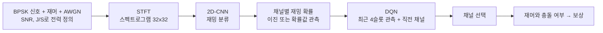

## 3. 파일 구성

| 파일 | 역할 |
|---|---|
| `signal_gen.py` | BPSK, 재머 4종 합성, SNR/J/S 기준 전력 설정, STFT 스펙트로그램 |
| `make_dataset.py` | CNN 학습/검증/테스트 데이터셋과 J/S, SNR 곡선용 고정 조건 세트 생성 |
| `train_cnn.py`, `eval_cnn.py` | CNN 정의, 학습, 혼동행렬, J/S·SNR별 정확도 곡선 |
| `env.py` | 채널 도약 환경(재머 5종, 관측 지연, 이진/확률 관측), CNN 출력 은행 |
| `dqn.py` | Double DQN, 표 기반 Q-learning |
| `run_e2e.py` | 실험 실행: `compare`, `sweep`, `history`, `delay`, `baselines`, `scenario` |
| `fec_eval.py` | 오류정정부호(BCH) 적용 시 프레임 오류율과 슬롯당 정보량 해석 |
| `deploy_bench.py` | 모델 크기, 연산량, CPU 추론 지연 측정, ONNX 내보내기 |
| `ber_eval.py` | BER 이론 검증, 재머 종류별 BER, 링크 BER 환산 |
| `channel.py` | 위성 채널 모델: 궤도 기하, 도플러, 링크 버짓 SNR, Rician 페이딩, 위상 잡음 |
| `realistic_eval.py` | 위성 채널에서 앙각별 CNN 탐지 평가, 채널 증강 데이터 생성, 위성 통과 실험 |
| `countermeasure_eval.py` | 재머 종류별 대응 선택의 링크 수준 평가 (간섭 제거, DSSS, BCH, 도약) |
| `adaptive_jammer_eval.py` | 적응형 재머와의 반복 게임 평가 (전력 예산, 반응 지연, 최소최대 혼합 전략, Hedge) |
| `inspect_mat.py` | 공개 실측 데이터 .mat 파일 구조 확인 (h5py, 메모리에 전부 올리지 않음) |
| `real_explore.py` | 실측 IQ의 스펙트럼, 반복 주기(심볼당 샘플 수), 시간에 따른 전력, 재밍 세기 추정 |
| `real_ber.py` | 실측 IQ의 BER, 타이밍 미끄러짐, 프레임 성공률(실측 대 무작위 오류 예측), 톤 제거 효과 |
| `real_detect.py` | 실측 IQ로 재밍 분류기 학습, 녹화 단위 교차 검증 (수신 전력, 신호처리 특징 + 로지스틱 회귀, CNN) |

## 4. 실행 방법

```
pip install numpy scipy matplotlib torch
# ONNX 내보내기(deploy_bench.py --onnx)를 쓰려면 추가로: pip install onnx onnxscript
python make_dataset.py
python train_cnn.py
python eval_cnn.py
python run_e2e.py compare --jammer multi --n-jammers 4 --channels 32 --jsr 8 --obs-quant binary --episodes 800 --table-episodes 30000 --seeds 5 --out-tag s5
python run_e2e.py history --jammer sequential --channels 8 --snr 5 --jsr -5 --obs-quant binary --histories 1 2 4 8 --episodes 300 --table-episodes 3000 --seeds 3 --out-tag h1248
python run_e2e.py delay --jammer multi --n-jammers 4 --channels 32 --jsr 8 --obs-quant binary --delays 0 2 4 --episodes 800 --table-episodes 30000 --seeds 5 --out-tag t30k
python run_e2e.py baselines --channels 32 --n-jammers 4 --jsr 8 --obs-quant binary --seeds 3 --ref-compare compare_multi4_c32_h4_d0_bin_final.json
python run_e2e.py baselines --channels 32 --n-jammers 4 --jsr 8 --obs-quant binary --seeds 5 --jammers multi static fhss_aware --out-tag j3
python run_e2e.py compare --jammer static --n-jammers 4 --channels 32 --jsr 8 --obs-quant binary --episodes 800 --table-episodes 10000 --seeds 5 --out-tag s5
python run_e2e.py ceiling --channels 32 --n-jammers 4
python run_e2e.py scenario --jammer multi --n-jammers 4 --channels 32 --jsr 8 --obs-quant binary --episodes 800 --table-episodes 10000 --seeds 2 --scenarios leo550 leo1200 meo8000 geo --slot-ms 10 --elev 25 --feedback rtt --proc-ms 12.3
python deploy_bench.py --cnn-path cnn_best.pt --channels 32 --history 4 --onnx
python fec_eval.py --link ber_link_compare_multi4_c32_h4_d0_bin_s5.json
python ber_eval.py validate
python ber_eval.py link --compare compare_multi4_c32_h4_d0_bin_s5.json
python realistic_eval.py dataset --out dataset_ch.npz
python train_cnn.py --data dataset_ch.npz --out cnn_ch.pt
python realistic_eval.py detect --cnn-path cnn_best.pt --compare-cnn cnn_ch.pt --out-tag leo550_aug
python realistic_eval.py pass --cnn-path cnn_ch.pt --out-tag leo550_aug
python realistic_eval.py pass --cnn-path cnn_best.pt --out-tag leo550_base
python countermeasure_eval.py --cnn-path cnn_best.pt --out-tag awgn
python countermeasure_eval.py --cnn-path cnn_best.pt --hop-fail 0.5 0.5 1.0 0.5 --out-tag awgn_hop50
python adaptive_jammer_eval.py --out-tag easy
python adaptive_jammer_eval.py --hop-fail 0.5 0.5 1.0 0.5 --out-tag hard
# 실측 데이터(6.16): Zenodo 7119040에서 w*.mat을 받아 저장소 밖 폴더에 두고 실행 (pip install h5py)
python inspect_mat.py C:\data\w27.mat
python real_explore.py C:\data\w27.mat
python real_ber.py C:\data\w1.mat C:\data\w15.mat C:\data\w21.mat C:\data\w27.mat
python real_ber.py C:\data\w12.mat C:\data\w19.mat C:\data\w27.mat --out-dir results\repeat
python real_detect.py extract C:\data\w1.mat C:\data\w12.mat C:\data\w15.mat C:\data\w19.mat C:\data\w21.mat C:\data\w27.mat
python real_detect.py train
python real_detect.py extract C:\data\w1.mat C:\data\w12.mat C:\data\w15.mat C:\data\w19.mat C:\data\w21.mat C:\data\w27.mat --win 32768 --nperseg 2048 --segments 40 --seg-len 262144 --cache-dir real_cache_w32k
python real_detect.py train --cache-dir real_cache_w32k --out-tag lofo_w32k
```

## 5. 시뮬레이션 모델

**신호**: 샘플링 2 kHz, 관측 0.5 s, 심볼률 100 baud(심볼당 20샘플)의 BPSK. 반송파 주파수와 위상은 샘플마다 무작위. SNR은 신호 전력 대 잡음 전력, J/S는 재머 전력 대 신호 전력(dB)으로 정의하고 신호 전력 기준으로 스케일링.

**재머**: 단일톤(주파수 무작위), 스윕(대역, 주기, 방향 무작위), 광대역 잡음, 부분대역 잡음. 모든 파라미터를 샘플마다 무작위화하여 CNN이 특정 값이 아니라 형태를 학습하도록 함.

**환경**: 에피소드당 100슬롯, 슬롯마다 에이전트가 채널 선택 후 재머가 이동, 충돌이면 보상 -1, 아니면 +1.

| 재머 모델 | 동작 |
|---|---|
| sequential | 확률 0.8로 다음 채널로 이동, 아니면 무작위 도약 |
| random | 매 슬롯 무작위 |
| reactive | 에이전트의 직전 채널을 확률 0.7로 추적 |
| permutation | 고정된 임의 순환 순서로 이동 |
| multi | n개의 독립 순차형 재머가 동시에 서로 다른 위치를 공격 |

**관측**: CNN이 낸 채널별 재밍 확률. `binary`는 0.5 임계로 이진 판정한 결과만 전달해 탐지 오류가 그대로 의사결정에 반영됨. 관측 지연 d슬롯은 센싱 결과가 d슬롯 늦게 도착하는 상황(위성 전파 지연 모사).

**이론 상한**: 재머 위치를 정확히 보고(오라클 관측) 재머의 이동 규칙도 아는 최적 정책의 기대 성공률. 관측이 d슬롯 늦으면 재머는 마지막 관측 뒤 d+1번 움직이고, 그동안 규칙대로만 움직였을 확률은 $p^{d+1}$ (p는 규칙대로 이동할 확률 0.8)이며 아니면 위치가 균등분포가 된다. 재머가 에이전트에 반응하지 않으므로 '규칙대로 갔을 채널'을 피하는 탐욕 정책이 최적이고, 재머 n개가 서로 독립이면 성공률은 $\left(1-\frac{1-p^{d+1}}{C}\right)^n$ (C는 채널 수). 재머끼리 겹쳐도 n < C이면 피할 채널이 항상 남으므로 근사가 아니라 정확한 값이다. 여기에 지연 d가 있을 때 에피소드 처음 d슬롯은 정보가 없어 무작위 수준이라는 점을 반영해 에피소드 평균으로 계산한다. 정확성은 6.12에서 몬테카를로로 검증.

**DQN**: Double DQN, 상태는 최근 4슬롯 관측과 직전 채널(one-hot), 은닉층 128, 학습률 1e-3, 할인율 0.9, 탐험률 선형 감소.

**비교 baseline**: 고정 채널, 랜덤 호핑, FHSS(공유 의사난수 패턴), 센싱 회피, AFH(최근 4슬롯 감지 채널 블랙리스트)(이상 학습 없음), 표 기반 Q-learning 4종(1스텝, 2스텝, 4스텝, 비트마스크), oracle DQN(재머 위치를 정확히 아는 상한).

## 6. 결과

### 6.1 CNN 재밍 분류
테스트 정확도 99.0% (정상 0.99, 단일톤 0.97, 스윕 1.00, 잡음 1.00). 학습 범위 밖(J/S -5 dB, SNR -5 dB)에서는 크게 하락: 광대역 잡음 재머가 정상으로, 정상 신호가 잡음 재밍으로 오분류됨.


### 6.2 재머 종류별 (8채널, SNR 10 dB, J/S 8 dB, 시드 3, 300 에피소드, 확률값 관측)

| 재머 | 랜덤 호핑 | DQN(CNN 관측) | DQN(oracle) | Q-table |
|---|---|---|---|---|
| 순차형 | 87.8% | 97.5% | 97.6% | 97.4% |
| 반응형 | 87.5% | 95.6% | 95.7% | 96.2% |
| 순환 순서형 | 87.7% | 97.7% | 97.3% | 97.5% |

모두 이론 상한에 근접했고, 이 정도 규모에서는 표 기반도 동일한 성능이었음(DQN 우위 없음). 초기 실험 결과이며 원본은 `results/early/`에 있음. 이진 관측으로는 다시 돌리지 않았음.

### 6.3 다중 재머와 채널 수 확장 (이진 관측, J/S 8 dB)

| 환경 | 랜덤 | 최고 표 기반 | DQN(CNN) | 이론 상한 |
|---|---|---|---|---|
| 재머 3, 8채널 | 66.9% | 92.3% (비트마스크) | 92.2% | 92.7% |
| 재머 3, 16채널 | 82.6% | 95.1% (비트마스크) | 95.8% | 96.3% |
| 재머 4, 32채널 (시드 5) | 88.3% | 94.3% (1스텝, 30000 에피소드) | 96.5% | 97.5% |

8채널은 400, 16채널은 600 에피소드, 시드 3개이며 원본은 `results/early/`에 있음. 8, 16채널의 표 기반은 DQN과 같은 학습 에피소드 수 조건. 32채널은 비트마스크 표(상태 2^32개)를 만들 수 없어 1스텝, 2스텝 표만 비교했고, 표를 5000 에피소드로 학습했을 때 92.5/93.1%, 30000 에피소드에서 1스텝 94.3±0.4%, 2스텝 93.8±0.4%(시드 5)였으며 약 15000 에피소드 이후 거의 평평해짐. 두 표의 차이는 표준편차 수준이라 구분할 수 없음(시드 2개일 때는 2스텝이 0.3%p 높아 보였으나 시드 5개에서 순서가 바뀜). DQN(CNN)은 96.5±0.3%로 시드별 96.1~97.0%이며, 표 기반의 가장 좋은 시드(94.7%)보다 모든 시드가 높음. DQN은 약 400 에피소드에 96~97%에 도달. 이전 2시드 실행(`_final`)은 `results/early/`에 보관.

해석: 표 기반 상태는 4개 재머 중 하나의 위치만 요약하는 반면 DQN은 32채널 전체의 감지 벡터를 입력으로 받아 쓰므로, 격차(약 2%p)는 학습량이 아니라 상태 표현의 한계에서 오는 것으로 보임. 다만 다른 방식의 상태 압축 표(예: 감지된 채널 집합 요약)는 시험하지 않았음.

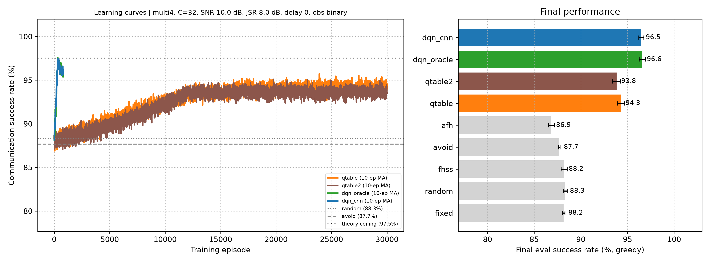

### 6.4 관측 이력 ablation (순차형, 이진 관측, SNR 5 dB, J/S -5 dB, 8채널)

| 이력 길이 | DQN(CNN 관측) |
|---|---|
| 1 | 92.1±0.8% |
| 2 | 94.0±0.3% |
| 4 | 94.9±0.3% |
| 8 | 94.9±0.1% |

oracle DQN은 이력과 무관하게 97.3~97.6%로 평평하므로, 이력은 재머 패턴 예측이 아니라 탐지 오류(미탐)를 메우는 데 쓰임. 표 기반을 3000 에피소드로 학습시키면 2스텝 94.7%, 4스텝 94.7%로 DQN(이력 4, 94.9±0.3%)과 구분되지 않음. 즉 8채널에서 DQN의 최종 성능 우위는 없고, 이득은 학습 속도와 채널 수 확장성에서 나옴.


### 6.5 관측 지연 (재머 4개, 32채널, 이진 관측, J/S 8 dB, DQN 800 / 표 30000 에피소드, 시드 5)

| 지연(슬롯) | 랜덤 | Q-table 1스텝 | Q-table 2스텝 | DQN(oracle) | DQN(CNN) | 이론 상한 |
|---|---|---|---|---|---|---|
| 0 | 88.3 | 94.3 | 93.8 | 96.6 | 96.5 | 97.5 |
| 2 | 88.3 | 91.0 | 90.9 | 92.6 | 92.8 | 93.9 |
| 4 | 88.3 | 89.4 | 89.6 | 90.8 | 90.5 | 91.7 |

- DQN(CNN)은 지연 0, 2, 4에서 이론 상한보다 각각 1.1, 1.2, 1.2%p 아래로, 거의 일정한 간격을 유지합니다.
- 표 기반을 30000 에피소드까지 충분히 학습시켜도 DQN이 각각 2.2, 1.7, 0.8%p 높습니다(가장 좋은 표 기준). 지연이 길수록 격차가 줄어드는 것은 예측에 쓸 정보 자체가 줄어 상한이 랜덤 쪽으로 내려오기 때문으로 해석합니다.
- 지연 0 행은 6.3과 같은 시드라 값이 같습니다. 이전의 표 기반 800 에피소드, 시드 2 결과는 `results/early/`에 보관했습니다.

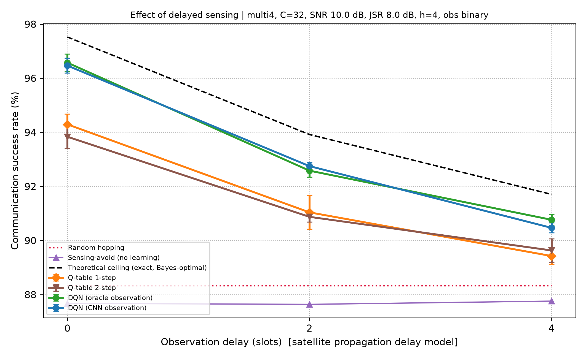

### 6.6 물리계층 BER 검증

- AWGN에서 BPSK BER 시뮬레이션이 이론식 $Q(\sqrt{2E_b/N_0})$와 일치(11개 점 중 10개는 1σ 이내이고, Eb/N0 6 dB 한 점은 시뮬레이션이 이론보다 약 15% 낮아 약 2.9σ 벗어남. 점이 11개라 우연일 수 있으나 재검증하지는 않음). 광대역 백색 재머가 있을 때도 SINR 기반 이론과 일치(최대 약 1σ).
- 재머 종류별: J/S가 낮을 때(0~6 dB)는 에너지가 집중되는 단일톤, 스윕, 부분대역 재머가 광대역 잡음보다 오류가 많고, J/S 9 dB 이상에서는 광대역 잡음이 가장 해로움.
- 링크 환산(32채널 다중 재머 4개, SNR 10 dB, J/S 8 dB): 재밍을 받은 슬롯의 BER은 약 4.6~6.6%로 사실상 손실이고, 평균 BER은 단일톤 재머 기준 랜덤 호핑 약 5.3e-3, DQN(CNN) 약 1.6e-3 (재머 종류별로 약 3.3배 감소, 피격률 11.7% → 3.5%와 같은 비율, 시드 5개 결과 기준). 정상 슬롯의 BER이 사실상 0이라 평균 BER은 피격률과 피격 슬롯 BER의 곱이며, 채널 부호화나 재전송 없이는 신뢰 통신 수준이 아님.


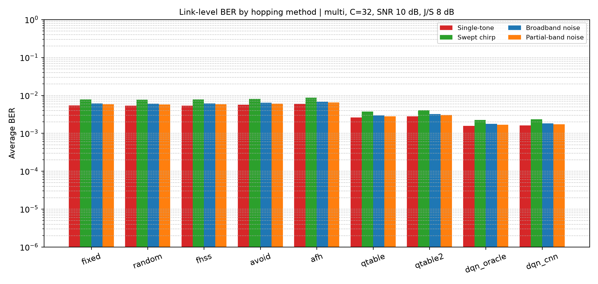

### 6.7 전통 기법(FHSS, AFH)과의 비교 (32채널, 이진 관측, J/S 8 dB)

| 재머 | 고정 | 랜덤 | FHSS | 센싱 회피 | AFH | 이론 상한 |
|---|---|---|---|---|---|---|
| 순차형(1개, 시드 3) | 97.0 | 96.8 | 96.9 | 97.0 | 96.7 | 99.4 |
| 무작위(시드 3) | 96.9 | 97.0 | 97.1 | 96.7 | 96.7 | 96.9 |
| 반응형(시드 3) | 29.7 | 96.9 | 99.1 | 97.0 | 96.7 | 99.0 |
| 순환 순서형(시드 3) | 96.9 | 96.9 | 96.8 | 96.9 | 96.8 | 99.4 |
| 다중 재머 4개 (시드 5) | 88.2 | 88.3 | 88.2 | 87.7 | 86.9 | 97.5 |
| 정적 재머 4개 (시드 5) | 89.1 | 88.0 | 88.1 | 99.8 | 99.8 | 99.8 |
| FHSS 패턴을 아는 재머 (시드 5) | 96.6 | 96.7 | 9.8 | 96.6 | 96.3 | 99.7 |

정적 재머는 한 채널에 평균 50슬롯 머물다가 무작위 채널로 옮깁니다(AFH가 원래 상대하도록 설계된 재머). FHSS 패턴을 아는 재머는 확률 0.9로 FHSS가 이번 슬롯에 쓸 채널을 공격하고, 아니면 무작위 채널을 공격합니다(패턴 유출 상황).

학습 방법까지 포함한 비교(시드 5):

| 재머 | 랜덤 | 센싱 회피 | AFH | 표 1스텝 | 표 2스텝 | DQN(oracle) | DQN(CNN) | 이론 상한 |
|---|---|---|---|---|---|---|---|---|
| 다중 재머 4개 (표 30000 에피소드) | 88.3 | 87.7 | 86.9 | 94.3 | 93.8 | 96.6 | 96.5 ± 0.3 | 97.5 |
| 정적 재머 4개 (표 10000 에피소드) | 88.0 | 99.8 | 99.8 | 97.2 | 95.9 | 98.3 | 98.0 ± 1.4 | 99.8 |

- 재머가 1개이고 채널이 32개면 무엇을 써도 약 97%라서 방법을 구분하지 못합니다. 이 시나리오는 변별력이 없고, 재머가 여러 개일 때 차이가 드러납니다.
- 재머 4개에서 학습이 없는 방법은 모두 88% 안팎에 머뭅니다. FHSS는 패턴을 모르는 재머에 대해 랜덤 호핑과 통계적으로 같고, 센싱 회피는 이득이 없으며, AFH는 랜덤보다 약 1.5%p 낮습니다. 이 환경의 재머는 매 슬롯 한 칸씩 이동하므로, 방금 감지된 채널을 피하거나 블랙리스트에 올리는 것은 재머가 이미 떠난 채널을 피하는 셈이기 때문으로 해석됩니다. 학습 기반 방법은 이 이동 규칙을 암묵적으로 이용해 6~8%p 높습니다(이 해석은 이론 상한식과 일치하는 정황이며 별도 실험으로 검증하지는 않았습니다).
- 정적 재머에서는 결과가 뒤집힙니다. 직전에 감지된 채널을 피하는 것만으로 이론 상한(99.8%)에 도달하고, 학습 방법은 오히려 낮습니다. 재머가 오래 머무르면 '방금 재밍된 채널'이 곧 '다음에도 재밍될 채널'이라 단순 규칙이 최적에 가깝기 때문입니다. 같은 AFH가 매 슬롯 움직이는 재머에서는 86.9%, 정적 재머에서는 99.8%로, 최적 기법은 재머의 움직임에 따라 달라집니다.
- 정적 재머에서 DQN은 학습 중 10에피소드 이동평균이 시드마다 99.7~99.8%까지 올라갔지만, 학습이 끝난 시점의 정책으로 평가하면 95.3~99.1%로 시드별 편차가 큽니다. 최고 성능 시점의 모델을 저장하는 처리가 없어 학습 후반의 흔들림이 그대로 남은 것으로 보입니다. 이 조건에서는 학습보다 단순 규칙을 쓰는 편이 낫습니다.
- 패턴을 아는 재머 앞에서 FHSS는 9.8%로 무너집니다. 다른 방법에게 이 재머는 무작위 재머와 같아 영향이 없습니다(96.3~96.7%). FHSS의 항재밍 효과는 패턴을 비밀로 유지하는 데 달려 있습니다.
- 반응형 재머에서 FHSS가 랜덤보다 높은 것은 이 모델의 재머가 에이전트의 직전 채널을 따라가고 FHSS 패턴은 같은 채널을 연속으로 쓰지 않기 때문이며, 결과적으로 이론 상한과 같은 수준입니다. 실제 시스템에서 FHSS가 우월하다는 증거로 해석하면 안 됩니다.
- FHSS의 처리 이득과 도청 저확률(LPI) 특성은 이 시뮬레이션에 반영하지 않았습니다.


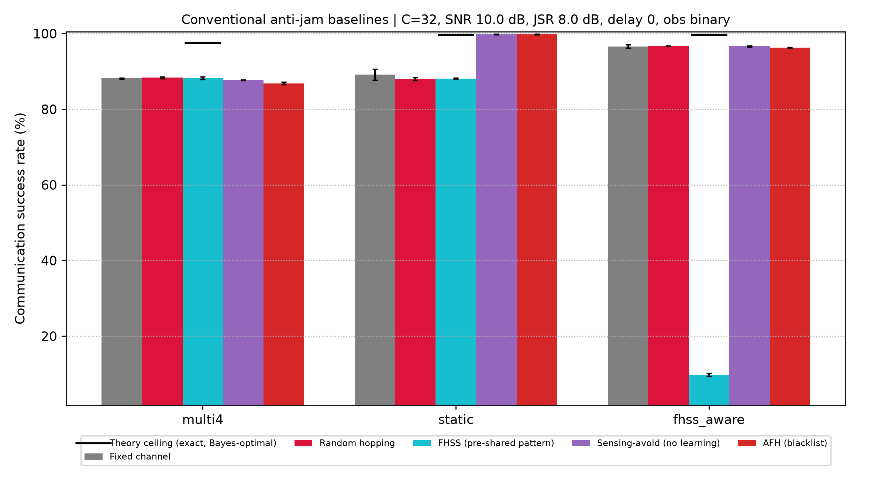
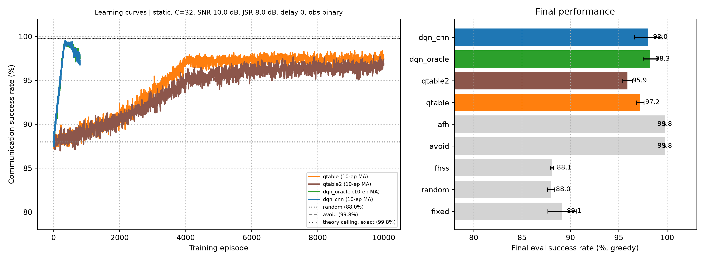

### 6.8 궤도별 관측 지연 시나리오 (32채널, 재머 4개, 이진 관측, J/S 8 dB, 시드 2)

고각 25도, 왕복 피드백, 슬롯 10 ms, 센싱 처리 지연 12.3 ms를 가정하고, 관측 지연을 d = ceil(경로 지연 / 슬롯 길이)로 환산했습니다. 궤도 고도는 공개된 대표값입니다.

| 시나리오 | 사거리(km) | 경로 지연(ms) | 지연 d | 랜덤 | 표 1스텝 | 표 2스텝 | DQN(CNN) | 이론 상한 |
|---|---|---|---|---|---|---|---|---|
| LEO 550km | 1123 | 19.8 | 2 | 88.5 | 90.4 | 90.8 | 92.9 | 93.9 |
| LEO 1200km | 2204 | 27.0 | 3 | 88.5 | 90.2 | 89.8 | 91.2 | 92.7 |
| MEO 8063km | 10536 | 82.6 | 9 | 88.5 | 88.1 | 88.2 | 88.4 | 89.2 |
| GEO 35786km | 39067 | 272.9 | 28 | 88.5 | 88.0 | 88.3 | 88.2 | 88.1 |

- LEO에서는 학습 방법이 랜덤 호핑보다 약 2.7~4.4%p 높고 DQN이 표 기반보다 높습니다. MEO 이상에서는 모든 방법이 랜덤 호핑 수준으로 수렴합니다. 슬롯이 전파 지연보다 훨씬 짧으면 폐루프 센싱으로는 이득을 볼 수 없다는 뜻이며, 이 경우에는 예측형이나 개루프 방식이 필요합니다.
- 결과는 가정값(슬롯 길이, 고각, 왕복 피드백)에 크게 의존합니다. 슬롯을 길게 잡으면 같은 궤도에서도 d가 작아집니다.
- GEO에서 랜덤(88.5)이 이론 상한(88.1)보다 높게 나온 것은 통계적 흔들림입니다. 무작위 호핑의 이론값은 88.07%, GEO 상한은 88.09%로 사실상 같고, 몬테카를로(6.12)에서 무작위 호핑은 88.13 ± 0.06%였습니다. 이 표는 시드 2, 표 기반 10000 에피소드 조건이며 이론 상한만 정확한 식으로 다시 계산했습니다.
- 처리 지연을 측정값(13.7 ms) 대신 12.3 ms로 넣었습니다. 13.7 ms를 쓰면 LEO 550km의 d는 3이 되어 DQN 91.2%에 해당합니다.


### 6.9 모델 크기와 추론 지연 (PC CPU 1스레드, PyTorch 2.15)

| 항목 | 값 |
|---|---|
| CNN | 파라미터 89,380개, FP32 349 kB, 채널당 2.57 M MACs |
| DQN (32채널, 이력 4) | 파라미터 41,248개, FP32 161 kB, 41.0 k MACs |
| STFT 1채널 | 0.17 ms |
| CNN 1채널 / 32채널 배치 | 0.32 ms / 7.7 ms |
| DQN 한 번 | 0.02 ms |
| 한 슬롯 전체(STFT 32채널 + CNN + DQN) | 13.7 ms (95퍼센타일 15.8 ms) |

- 두 모델 합쳐 약 510 kB(FP32)라 임베디드에 올리기에 작은 편입니다.
- 한 슬롯 처리 시간(13.7 ms)이 6.8의 슬롯 길이(10 ms)보다 깁니다. 이 PC에서 1스레드로는 10 ms 슬롯을 실시간으로 처리하지 못하며, STFT 일괄 처리나 GPU, FPGA 이식이 필요합니다. 임베디드 실측이 아니라 PC 값입니다.

### 6.10 오류정정부호(FEC)와 프레임 오류율 (해석적 모델)

슬롯 하나에 부호어(프레임) 하나를 싣고, 피격된 슬롯의 모든 비트가 6.6의 피격 슬롯 BER(4.6~6.6%)로 깨진다고 가정했습니다. 부호는 한계거리 복호(t개까지 정정)의 BCH로 두고 실제 부호기, 복호기는 구현하지 않았습니다. 피격률은 32채널 재머 4개 비교(6.3)의 값입니다.

프레임 오류율(%), 광대역 잡음 재머:

| 방법 | 부호 없음(k=64) | BCH(63,36,t=5) | BCH(127,64,t=10) | BCH(255,131,t=18) |
|---|---|---|---|---|
| 랜덤 호핑 | 11.3 | 1.24 | 0.76 | 0.84 |
| 표 기반 1스텝 | 5.5 | 0.61 | 0.37 | 0.41 |
| DQN(CNN) | 3.4 | 0.38 | 0.23 | 0.25 |

- 프레임 오류율은 피격률에 비례해서, 어떤 부호를 쓰든 DQN은 랜덤 호핑 대비 약 3.3배 낮습니다. 부호와 채널 선택의 효과는 곱으로 쌓입니다. 랜덤+부호 없음(11.3%)에서 DQN+BCH(127,64)(0.23%)까지 약 49배 감소하고, 스윕 재머처럼 BER이 높은 경우(11.5% → 0.76%)에는 약 15배입니다.
- 부호화의 대가는 정보량입니다. 재전송 없이 슬롯당 전달되는 정보량은 부호 없음 DQN이 약 0.97, BCH(127,64)는 약 0.50입니다. 피격이 드문 환경에서는 부호 없이 재전송(ARQ)을 쓰는 편이 평균 처리량은 높고, 부호는 재전송이 비싼 경우(왕복 지연이 긴 위성 링크 등)에 첫 전송의 신뢰도를 높이는 용도입니다.
- 스윕 재머(피격 슬롯 BER 6.6%)에서는 가장 긴 BCH(255,131,t=18)가 BCH(127,64,t=10)보다 프레임 오류율이 높습니다. 정정 가능 비율(t/n 약 7.1%)이 BER(6.6%)에 너무 가까워 오류 개수 분포의 꼬리에 걸리기 때문입니다. 즉 코드율을 더 낮춰야 합니다.
- FER 0.1% 이하를 만족하는 데 필요한 최소 정정 능력(n=127)은 랜덤 호핑 12~16, DQN 11~14로, 채널 선택이 부호 설계 요구를 1~2 정도만 낮춥니다.
- 가정: 슬롯 안에서 오류가 독립(인터리빙 가정), 부호화 비트당 에너지 불변, 재머 종류별 BER은 6.6의 값. 실제 재머의 오류는 슬롯 안에서 몰릴 수 있습니다.

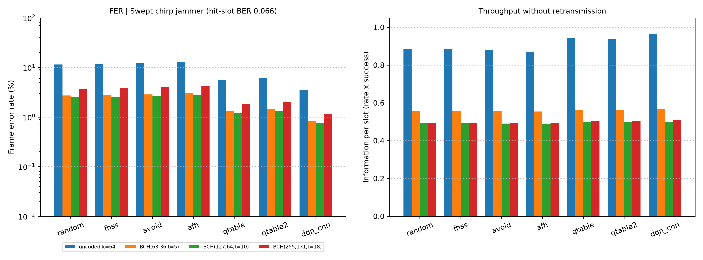

### 6.11 위성 채널에서의 재밍 탐지 (LEO 550 km, J/S 8 dB, 클래스당 300장, 시드 1)

6.1의 CNN은 AWGN과 재머만 있는 데이터로 학습했습니다. 여기서는 `channel.py`로 앙각에 따라 변하는 위성 채널을 더해 같은 CNN의 탐지 성능을 보고, 채널을 넣은 데이터로 다시 학습한 CNN(채널 증강)과 비교했습니다. 아래 수치는 모두 가정값이며 특정 실제 시스템의 사양이 아닙니다.

| 항목 | 가정값 |
|---|---|
| 궤도 | 원궤도 550 km, 관측자 바로 위를 지나는 통과, 지구 자전 무시 |
| 반송파, 심볼률 | 2.2 GHz, 100 ksps |
| 링크 SNR | 천정 15 dB 기준, 사거리에 따른 자유공간 손실 차이와 대기 손실(천정 0.2 dB, 1/sin(앙각)로 증가) 반영 |
| 페이딩 | 관측 구간 안에서 일정한 flat Rician, K 인수 3 dB(앙각 10도)에서 15 dB(90도)까지 선형 |
| 위상 잡음 | 샘플당 표준편차 0.005 rad의 랜덤워크 |
| 도플러 | 보상 없음. 시뮬레이션이 100 baud로 축소된 모델이라 심볼률 대비 비율(fd/Rs)로 환산해 적용 |
| 재머 | 지상 재머를 가정해 도플러와 페이딩을 받지 않음 |

균형 탐지 정확도(%)와 오탐률(FPR)입니다. 조건마다 한 요소씩 켰고, 링크 SNR은 모든 조건에서 앙각에 따라 변합니다.

| 앙각 | 링크 SNR (dB) | 도플러 (kHz) | AWGN만 | +도플러 | +페이딩 | 전부 | 전부, 증강 CNN | FPR 기존 → 증강 |
|---|---|---|---|---|---|---|---|---|
| 10° | 3.7 | 50.5 | 100.0 | 99.8 | 89.3 | 91.0 | 94.3 | 18.0% → 11.0% |
| 20° | 7.2 | 48.2 | 99.5 | 100.0 | 97.7 | 97.0 | 97.9 | 6.0% → 4.0% |
| 30° | 9.7 | 44.4 | 100.0 | 100.0 | 99.7 | 98.8 | 99.7 | 2.3% → 0.7% |
| 45° | 12.2 | 36.3 | 100.0 | 99.8 | 100.0 | 99.8 | 99.8 | 0.3% → 0.3% |
| 60° | 13.8 | 25.6 | 99.8 | 100.0 | 100.0 | 100.0 | 99.9 | 0.0% → 0.0% |
| 75° | 14.7 | 13.3 | 99.7 | 100.0 | 99.8 | 99.7 | 99.8 | 0.7% → 0.3% |
| 90° | 15.0 | 0.0 | 99.8 | 100.0 | 99.8 | 100.0 | 99.8 | 0.0% → 0.3% |

- 도플러만 넣었을 때는 성능 변화가 없습니다. CNN을 학습할 때 반송파 주파수를 무작위로 바꿨기 때문에, 이 가정(심볼률 100 ksps)에서의 도플러 이동은 학습 범위 안에 들어갑니다. 심볼률이 더 낮으면 fd/Rs가 커져 결과가 달라질 수 있습니다.
- 성능 저하의 주원인은 낮은 앙각의 페이딩입니다. 재밍을 놓치지는 않고(TPR은 모든 조건에서 99.7% 이상), 신호가 깊게 꺼진 정상 채널을 재밍으로 잘못 판정하는 오탐이 늘어납니다.
- 채널 증강 재학습(학습 데이터의 절반을 현실 채널 샘플로 교체, 학습과 평가 샘플은 다른 시드)으로 앙각 10도의 오탐이 18%에서 11%로 줄었습니다. AWGN 조건 정확도는 99.7~100%로 유지되어 깨끗한 조건의 성능을 잃지 않았습니다. 같은 평가 샘플에서 비교했고, 10도의 오탐 차이는 표본 오차의 약 2.5배입니다(시드 1개).
- 남은 오탐의 원인은 전처리로 추정합니다. 스펙트로그램을 샘플마다 표준화하므로 CNN은 절대 수신 전력을 볼 수 없고, 깊게 꺼진 신호는 표준화 후 광대역 잡음 재밍과 비슷해집니다. 이 가설은 검증하지 않았습니다. 수신 전력을 추가 입력으로 넣거나 여러 슬롯의 판정을 평균하는 방법이 다음 후보입니다.
- 앙각 20도 이상에서는 두 CNN 모두 97% 이상입니다. 운용 최저 앙각을 두는 것도 대안입니다.
- 이 오탐이 DQN 통신 성공률에 주는 영향은 평가하지 않았습니다. 6.3~6.8의 DQN 결과는 AWGN 채널의 CNN 출력으로 얻은 값입니다.


### 6.12 이론 상한 검증 (32채널, 다중/정적 재머 4개, 1000 에피소드 × 시드 5)

재머 위치(지연 반영)와 이동 규칙을 아는 베이즈 최적 정책(`BayesPolicy`)을 실제로 돌려 5장의 상한식과 비교했습니다. CNN이 필요 없는 계산입니다.

| 재머 | 지연 d | 이론식 | 베이즈 최적 정책 (평균 ± 표준오차) |
|---|---|---|---|
| 다중 4개 | 0 | 97.52 | 97.51 ± 0.02 |
| 다중 4개 | 2 | 93.92 | 93.89 ± 0.02 |
| 다중 4개 | 4 | 91.71 | 91.69 ± 0.02 |
| 다중 4개 | 28 | 88.09 | 88.13 ± 0.05 |
| 순차형 1개 | 0 | 99.38 | 99.37 ± 0.01 |
| 순차형 1개 | 4 | 97.86 | 97.83 ± 0.03 |
| 정적 4개 | 0 | 99.75 | 99.76 (표준오차 0.01 미만) |
| 정적 4개 | 28 | 92.75 | 92.78 ± 0.07 |
| 반응형 | 0 | 99.04 | 99.06 ± 0.01 |
| 패턴을 아는 재머 | 0 | 99.69 | 99.69 ± 0.01 |

- 순환 순서형, 무작위형까지 7개 재머 모델, 지연 0, 2, 4, 28의 모든 조합에서 이론식과 몬테카를로가 표준오차의 1~2배 안에서 일치했습니다. 전체 결과는 `results/ceiling_check_c32_n4.json`에 있습니다.
- 무작위 호핑의 이론값 88.07%도 몬테카를로 88.13 ± 0.06%와 일치합니다. 6.3에서 랜덤이 88.3%로 조금 높게 나온 것은 통계적 흔들림입니다.
- 이 상한은 이 시뮬레이터의 재머 모델(독립, 균등 무작위 도약) 안에서 정확한 값이며, 실제 재머에 대한 상한은 아닙니다.

### 6.13 위성 한 번 통과 동안의 통신 성공률 (채널 → CNN → DQN, LEO 550 km)

6.11의 위성 채널을 DQN까지 연결했습니다. 관측자 바로 위를 지나는 LEO 550 km 위성을 앙각 10도 이상에서 쓴다고 보면 가시 시간은 약 476초이고, 앙각마다 머무는 시간 비율을 궤도 기하로 계산했습니다. 앙각별로 채널 증강 CNN(`cnn_ch.pt`)의 탐지 결과를 만들고, 정책은 통과 시간 비율대로 섞은 탐지 결과로 한 번 학습한 뒤 앙각별로 평가했습니다. 재머 4개, 32채널, 이진 관측, 지연 0, J/S 8 dB, DQN 800 / 표 10000 에피소드, 시드 3입니다.

| 앙각 | 시간 비율 | CNN 오탐률 | 랜덤 | AFH | 표 1스텝 | DQN(oracle) | DQN(CNN) |
|---|---|---|---|---|---|---|---|
| 10° | 18.3% | 11.0% | 88.4 | 87.1 | 92.9 | 96.4 | 93.3 |
| 20° | 25.2% | 4.0% | 88.4 | 87.2 | 93.6 | 96.6 | 95.8 |
| 30° | 19.2% | 0.6% | 88.3 | 87.3 | 93.9 | 96.5 | 96.6 |
| 45° | 14.5% | 0.2% | 88.3 | 87.0 | 94.0 | 96.3 | 96.5 |
| 60° | 10.3% | 0.4% | 88.0 | 86.8 | 94.2 | 96.5 | 96.7 |
| 75° | 8.5% | 0.0% | 88.1 | 87.1 | 94.3 | 96.4 | 96.7 |
| 90° | 4.0% | 0.4% | 88.2 | 86.8 | 94.4 | 96.6 | 96.4 |
| **통과 평균** | | | 88.3 ± 0.1 | 87.1 ± 0.1 | 93.7 ± 0.1 | 96.5 ± 0.1 | **95.8 ± 0.1** |

- 통과 전체의 시간 가중 성공률은 DQN(CNN) 95.8%로, 정답 관측 DQN(96.5%)보다 0.7%p 낮고 표 기반보다 2.1%p, 랜덤보다 7.5%p 높습니다.
- 손실은 낮은 앙각에 몰려 있습니다. 앙각 10도에서는 CNN 오탐 11%로 정답 관측보다 3.1%p 낮고, 20도에서는 0.8%p 낮으며, 30도 이상에서는 차이가 없습니다. 통과 시간의 약 44%가 앙각 25도 이하라 이 구간의 오탐이 통과 전체 성능을 좌우합니다.
- 표 기반은 앙각 10도와 90도의 차이가 1.5%p로 DQN보다 작습니다. DQN은 32채널 감지 벡터 전체를 입력으로 쓰기 때문에 오탐에 더 민감한 것으로 추정합니다(검증하지 않음).
- 기존 CNN(AWGN 데이터로만 학습)과 채널 증강 CNN을 같은 조건으로 비교했습니다.

| CNN | 10° 오탐률 | 20° 오탐률 | 10°의 DQN(CNN) | 통과 평균 DQN(CNN) | 통과 평균 표 1스텝 |
|---|---|---|---|---|---|
| 기존 (`cnn_best.pt`) | 20.0% | 6.8% | 92.4 | 95.6 ± 0.1 | 93.8 ± 0.4 |
| 채널 증강 (`cnn_ch.pt`) | 11.0% | 4.0% | 93.3 | 95.8 ± 0.1 | 93.7 ± 0.1 |

- 채널 증강으로 앙각 10도의 오탐이 거의 절반이 되었고 그 앙각의 DQN 성공률은 약 1.0%p 올랐지만, 통과 전체로는 0.2%p 개선에 그칩니다(시드 3, 표준오차의 약 2.5배). 10도 구간은 통과 시간의 18%뿐이고 20도 이상에서는 이미 차이가 작기 때문입니다. 탐지 지표의 큰 개선이 시스템 지표에서는 작게 나타날 수 있어, 성능은 최종 통신 성공률로 평가해야 합니다. 표 기반은 두 CNN 사이에 차이가 없습니다.
- 운용 측면에서는 낮은 앙각의 오탐을 줄이는 것(6.11의 수신 전력 입력 가설)이 가장 효과가 큰 개선 방향입니다.
- 관측자 바로 위를 지나는 궤도 하나, 지연 0만 다뤘습니다. 실제 통과는 최고 앙각이 낮은 경우가 더 많아 저앙각 비중이 더 커집니다.

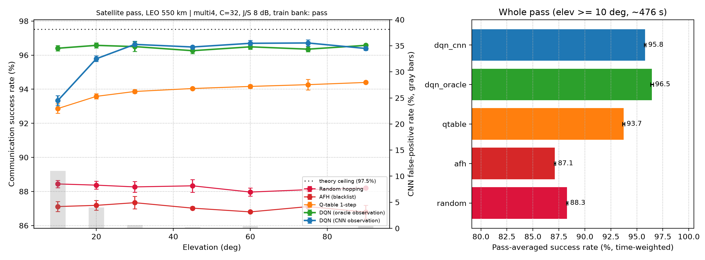


### 6.14 재머 종류에 맞는 대응 선택 (링크 수준, SNR 10 dB, AWGN)

지금까지의 실험은 재밍을 감지하면 채널을 옮기는 '회피'만 다뤘습니다. 여기서는 재머 종류에 따라 대응 자체를 고르는 알고리즘을 만들고, 매 슬롯 실제 파형을 보내고 받아 처리량을 계산했습니다.

**대응(행동) 14가지**

| 대응 | 동작 | 비용 |
|---|---|---|
| 그대로 전송 | 일반 BPSK | 없음 |
| 간섭 제거 | 수신 신호의 STFT에서 기준(정상 신호의 99.9 백분위)보다 센 칸을 지우고 복원 | 정상 신호 손실 거의 없음 |
| DSSS 2배, 4배 | 같은 대역폭에서 비트 하나를 2개, 4개 칩으로 확산 | 정보량 1/2, 1/4 |
| BCH 부호 | 단축 BCH (50,38,t=2), (50,23,t=5), (50,11,t=7), 오류가 t개 이하면 성공 | 정보량 76%, 46%, 22% |
| 도약 | 다른 채널로 이동, 종류별 실패 확률(가정값) | 정착 시간 5% |

그대로 전송, 간섭 제거, 도약은 각각 4가지 부호와 조합됩니다. 처리량은 성공한 프레임의 정보 비트 수를 슬롯당 최대 50비트로 나눈 값입니다.

**전략**은 '무엇을 알고 대응을 고르나'만 다릅니다. 관측값마다 처리량이 가장 큰 대응을 데이터의 절반으로 정하고(조회표), 나머지 절반으로 평가했습니다. 정상 슬롯과 재밍 슬롯의 비중은 같게 두었고, J/S는 −10~20 dB, 조건당 600슬롯입니다.

**검증**: 정상 채널에서 일반 BPSK와 DSSS의 BER이 이론값과 일치했습니다(SNR −10 dB에서 0.0788 대 이론 0.0786). 간섭 제거는 J/S 8 dB에서 단일톤 BER을 3.9%에서 0.8%로, 스윕을 8.2%에서 1.5%로 낮췄지만 광대역 잡음은 5.3%에서 7.4%로 오히려 나빠졌습니다. 채널 전체를 덮는 광대역 잡음에는 확산의 처리 이득이 아니라 속도를 낮춰 비트당 에너지를 늘리는 것만 효과가 있습니다.

**종합 처리량** (재밍 슬롯 4종 평균과 정상 슬롯의 평균)

| 전략 | 도약이 쉬운 조건 | 도약이 어려운 조건 |
|---|---|---|
| 대응 없음 | 0.808 | 0.808 |
| 항상 도약 (지금까지의 방식) | 0.895 | 0.854 |
| 에너지 검출 + 최선의 고정 대응 | 0.895 | 0.862 |
| 재머 종류만 앎 (분류 완벽) | 0.898 | 0.872 |
| CNN 분류 | 0.900 | 0.877 |
| 종류 + 추정 세기 (분류 완벽) | 0.912 | 0.892 |
| **CNN 분류 + 추정 세기** | **0.912** | **0.891** |
| 정답 (종류와 실제 J/S) | 0.914 | 0.896 |

도약 실패 확률은 '쉬운 조건'에서 단일톤 0.05, 스윕 0.25, 부분대역 0.10, '어려운 조건'에서 셋 다 0.5이고, 전 대역 광대역 잡음은 두 조건 모두 1.0입니다(가정값).

- **CNN 분류에 수신 전력 추정을 더하면 종류를 완벽히 아는 경우와 같은 성능**입니다(0.912 대 0.912, 0.891 대 0.892). 정답과의 차이도 0.002~0.005입니다. 학습된 복잡한 정책 없이 '분류 결과와 세기 구간 → 대응' 조회표로 충분합니다.
- **종류 정보의 가치는 도약으로 빠져나가기 어려울 때 커집니다.** 도약이 쉬운 조건에서는 항상 도약이 거의 최적이라 이득이 작고(0.895 → 0.912), 어려운 조건에서는 이득이 커집니다(0.854 → 0.891). 어려운 조건에서 4종 평균 처리량이 절반으로 떨어지는 J/S는 항상 도약 13.5 dB, 에너지 검출 + 고정 대응 15.1 dB, CNN 분류 + 세기 20 dB 이상입니다. 스윕 재머만 보면 항상 도약은 10.1 dB에서 절반이 되지만, 종류를 알고 '간섭 제거 + 약한 부호'를 고르면 20 dB까지 절반 위를 유지합니다.
- **전 대역 광대역 잡음**은 도약이 소용없어 부호 강도를 J/S에 맞춰 높여야 합니다(J/S 5~7.5 dB는 BCH t=2, 10 dB는 t=5, 12.5 dB 이상은 DSSS 4배). 이를 위해 종류와 세기가 모두 필요하고, 처리량이 절반이 되는 J/S가 5.3 dB에서 7.0 dB로 1.7 dB 올라갑니다. 종류만 알면 이득이 없습니다.
- **CNN이 필요한 이유는 감지가 아니라 분류입니다.** 이 조건에서 에너지 검출기는 J/S −10 dB에서도 감지율 90% 이상, 오탐 0.35%로 감지에는 충분합니다. 그러나 에너지 검출만으로는 대응을 고를 수 없어, 고정 대응을 써야 하고 성능이 항상 도약 수준에 머뭅니다.
- CNN은 부분대역 잡음을 학습하지 않았지만(4클래스), 처음 보는 재머에도 조회표가 다른 클래스의 대응을 연결해 성능 저하가 거의 없었습니다.
- 결과는 도약 실패 확률 가정에 크게 의존하므로 두 조건을 함께 보고합니다. 대응을 동시에 여러 개 쓰는 경우(예: 도약과 부호화), 위성 채널(페이딩)에서의 비교, 재머가 우리 대응에 적응하는 경우는 다루지 않았습니다.

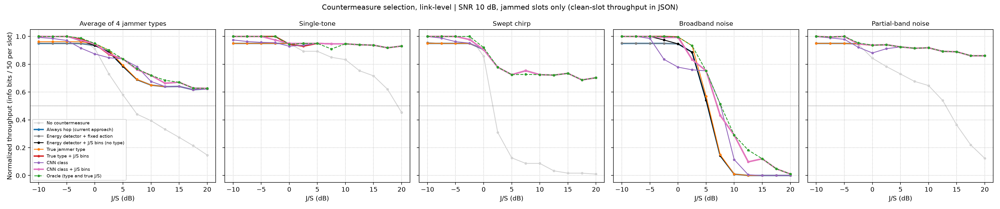
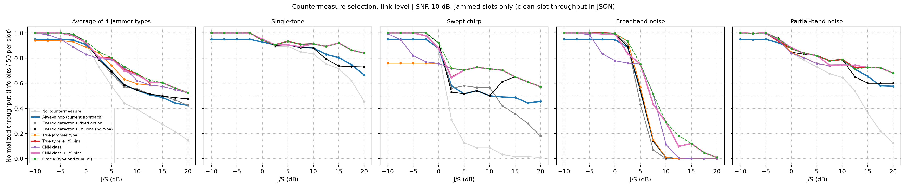

### 6.15 적응형 재머와의 반복 게임 (2단계)

6.14는 재머가 정해진 비율로 종류를 섞는다고 가정했습니다. 실제 위협은 우리 대응을 보고 바꾸는 재머입니다. 6.14의 링크 시뮬레이션으로 '대응 × 재머 종류'별 처리량 표본을 만들고, 매 슬롯 재머와 방어 측이 고르는 반복 게임을 2000슬롯 × 시드 5로 돌렸습니다.

**재머 전력 예산**: 재머의 총 전력 P(한 채널에 모두 쏠 때의 J/S)는 정해져 있고, 넓게 쏠수록 채널당 세기가 약해집니다. 스윕은 순간적으로 좁은 대역 하나라 J/S = P, 단일톤 4개는 P − 6 dB, 부분대역(32채널 중 8채널)은 P − 9 dB, 광대역 잡음(32채널 전체)은 P − 15 dB입니다. 방어 측은 슬롯이 끝난 뒤 그 슬롯의 재머 종류를 정확히 안다고 봤습니다(6.14에서 CNN + 세기가 완벽한 분류와 같은 성능).

| 방어 전략 | 설명 |
|---|---|
| 항상 도약 | 지금까지의 방식 |
| 조회표, 한 슬롯 늦음 | 직전 슬롯의 재머 종류에 대한 최선의 대응 (현실적인 1단계 알고리즘) |
| 조회표, 지연 없음 | 이번 슬롯의 재머 종류를 보고 바로 대응 (6.14의 가정, 낙관적) |
| 최소최대 혼합 전략 | 관측을 쓰지 않고, 최악의 재머에 대한 처리량을 최대로 하는 혼합 전략(선형계획)에서 무작위로 고름 |
| Hedge | 지난 슬롯들의 재머 종류로 모든 대응의 처리량을 갱신하는 온라인 학습 |

재머는 다섯 가지입니다. 가장 해로운 한 종류 고정, 매 슬롯 무작위, 게임 이론의 최적 혼합, 우리의 직전 대응에 가장 해로운 종류를 고르는 추종형, 우리 처리량만 보고 학습하는 밴딧(EXP3) 재머입니다.

**다섯 재머 중 최악의 경우 처리량**, 도약이 쉬운 조건(6.14와 같은 가정)

| 재머 전력 P | 게임 값 (보장) | 항상 도약 | 조회표, 한 슬롯 늦음 | 조회표, 지연 없음 | 최소최대 | Hedge |
|---|---|---|---|---|---|---|
| 5 dB | 0.712 | 0.707 | 0.698 | 0.707 | 0.706 | 0.692 |
| 10 dB | 0.734 | 0.730 | 0.730 | 0.730 | 0.730 | 0.720 |
| 15 dB | 0.788 | 0.786 | 0.786 | 0.786 | 0.787 | 0.776 |
| 20 dB | 0.657 | 0.607 | **0.527** | **0.738** | 0.657 | 0.645 |

도약이 어려운 조건(도약 실패 0.5)

| 재머 전력 P | 게임 값 (보장) | 항상 도약 | 조회표, 한 슬롯 늦음 | 조회표, 지연 없음 | 최소최대 | Hedge |
|---|---|---|---|---|---|---|
| 5 dB | 0.695 | 0.519 | 0.675 | 0.698 | 0.691 | 0.679 |
| 10 dB | 0.707 | **0.478** | 0.681 | 0.707 | 0.708 | 0.694 |
| 15 dB | 0.647 | 0.540 | 0.638 | 0.663 | 0.644 | 0.630 |
| 20 dB | 0.522 | 0.481 | 0.507 | 0.516 | 0.518 | 0.507 |

- **전력 예산이 있으면 재머의 최선은 '좁고 강하게'입니다.** 대부분의 조건에서 재머의 최적 전략은 스윕 하나로 집중하는 것이고, 광대역 잡음은 전력이 32채널로 나뉘어 P = 15 dB까지는 거의 해가 없습니다. 재머가 한 종류에 집중하면 종류를 아는 모든 전략이 게임 값에 도달하고, 적응형 재머가 더 얻을 것이 없습니다.
- **한 슬롯 늦은 결정적 조회표는 공략당할 수 있습니다.** 도약이 쉬운 조건에서 P = 20 dB면 재머의 최적 전략이 스윕과 광대역 잡음의 혼합이 되어 다음 종류를 예측할 수 없습니다. 이때 추종형 재머가 우리의 직전 대응에 가장 해로운 종류를 골라 처리량을 0.527까지 떨어뜨립니다. 보장값 0.657보다 13%p 낮습니다.
- **무작위화와 온라인 학습이 이를 막습니다.** 최소최대 혼합 전략은 모든 조건에서 게임 값을 지키고(0.657), Hedge도 학습 비용만큼(0.01~0.02) 아래에서 따라갑니다. 다만 최소최대는 재머가 약하게 굴 때 이득을 놓칩니다. 예를 들어 도약이 어려운 조건, P = 10 dB, 무작위 재머에서 최소최대 0.725, Hedge 0.797, 지연 없는 조회표 0.875입니다.
- **반응 속도가 가장 큰 무기입니다.** 같은 슬롯 안에서 재머 종류를 보고 대응하면 보장값보다 높은 0.738을 얻습니다(P = 20 dB). 6.9에서 한 슬롯 처리 시간(13.7 ms)이 슬롯 길이(10 ms)보다 길었으므로, 처리 지연을 줄이는 것이 곧 항재밍 성능입니다.
- **항상 도약은 도약이 어려울 때 크게 약합니다.** 재머가 스윕만 쓰면 0.478로 보장값 0.707보다 23%p 낮습니다.
- 재머가 우리 대응을 정확히 관측한다는 가정은 재머에게 유리한 최악 가정입니다. 게임 값은 이 시뮬레이터의 대응과 재머 종류 안에서의 값이며, 대응을 여러 개 동시에 쓰거나 재머가 전력 배분을 연속적으로 바꾸는 경우는 다루지 않았습니다.

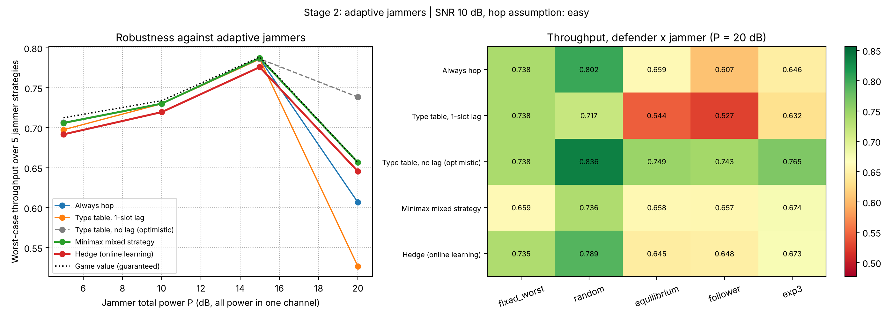
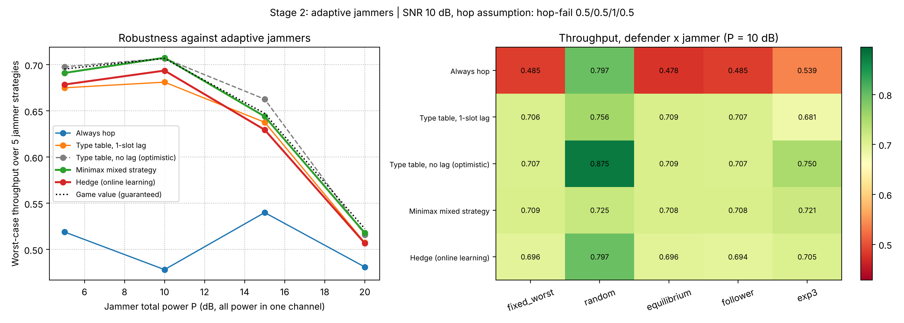

### 6.16 공개 실측 데이터 검증 (실내 재밍 IQ 데이터셋)

지금까지는 모두 합성 신호였습니다. 실제 수신 신호로 재밍의 영향을 확인하려고 공개 데이터셋을 사용했습니다.

- **데이터**: Alhazbi, Sciancalepore, Oligeri, "A Dataset of physical-layer measurements in indoor wireless jamming scenarios", *Data in Brief* 46 (2023) 108773, [Zenodo 7119040](https://zenodo.org/records/7119040), CC BY 4.0. USRP X310 송신기, 수신기, 재머로 구성한 실내 비가시선(NLOS) 환경입니다. BPSK이고, 재밍은 없음 / 단일톤 / 가우시안 잡음 세 가지이며 조건마다 600초씩 녹화되어 있습니다. 파일 w1~w31은 재머 상대 전력(0.1~0.8), 재머 장비(4~8번), 거리(3~21 m)를 바꿔 가며 녹화했습니다. 데이터(파일당 약 4 GB)는 이 저장소에 포함하지 않았습니다.
- **신호 형태 확인** (`real_explore.py`): 재밍 없음 신호의 자기상관이 2048샘플마다 0.999이고, 스펙트럼은 1/8 간격의 골과 −0.4375의 피크를 보입니다. 0~255를 세는 바이트열(2048비트)을 심볼당 1샘플로 보낸 BPSK의 스펙트럼과 정확히 일치합니다. 따라서 저장된 신호는 1샘플이 1심볼이고 송신 비트열을 알 수 있습니다.
- **그래서 스펙트로그램 CNN은 적용하지 않았습니다.** 6.1의 CNN은 반송파 위의 BPSK와 재머가 차지한 주파수 대역의 모양을 학습했는데, 이 데이터의 스펙트럼은 비트 패턴의 모양이라 그대로 넣는 것은 의미가 없습니다. 대신 비트열을 알고 있으므로 실측 BER을 직접 측정했습니다.
- **수신 전력만으로는 재밍을 알 수 없습니다.** w27에서 블록 평균 전력은 재밍 없음 1.33, 톤 1.32, 잡음 1.25로 거의 같습니다(수신기 AGC나 정규화로 보임). 반면 스펙트럼에서는 톤이 DC 위치의 +65 dB 선으로, 잡음이 신호 선 사이 바닥의 10~20 dB 상승으로 뚜렷이 보입니다.
- **측정 방법** (`real_ber.py`): 파일마다 녹화 전체에 고르게 퍼진 8개 구간(구간당 2^20 심볼)을 사용했습니다. 256심볼마다 직전 위치의 ±3심볼 안에서 타이밍을 다시 찾고(이 비트열은 1~3심볼 어긋난 위치와의 상관이 0), 2048심볼마다 전체 탐색으로 큰 점프를 다시 맞춥니다. 이득과 위상도 같은 구간의 기지 비트열로 추정합니다. 즉 **완벽한 파일럿 동기를 가정한 값**입니다. 타이밍이 미끄러져 생긴 오류도 그대로 셌습니다. BCH 프레임 성공률은 50비트 프레임 안의 오류 개수가 정정 능력 t 이하인지로 판정하고, 같은 BER의 무작위(i.i.d.) 오류로 계산한 예측과 비교했습니다.

**재머 전력과 장비별 실측 BER** (거리 10 m)

| 파일 | 재머 장비, 상대 전력 | 재밍 없음 | 톤 | 가우시안 잡음 | 타이밍 미끄러짐 (톤 / 잡음) |
|---|---|---|---|---|---|
| w1 | 4번, 0.1 | 7.4×10⁻⁵ | 7.0×10⁻⁵ | 9.1×10⁻⁵ | 4 / 4 |
| w27 | 4번, 0.5 | 9.5×10⁻⁷ | 9.1×10⁻³ | 2.5×10⁻² | 1977 / 5542 |
| w15 | 4번, 0.8 | 5.7×10⁻⁵ | 0.41 | 0.44 | 26705 / 26747 |
| w21 | 6번, 0.5 | 8.9×10⁻⁵ | 6.0×10⁻⁵ | 1.0×10⁻³ | 3 / 250 |

**같은 조건(재머 4번, 상대 전력 0.5, 10 m) 3회 반복**

| 파일 | 재밍 없음 | 톤 | 가우시안 잡음 | 타이밍 미끄러짐 (톤 / 잡음) |
|---|---|---|---|---|
| w12 | 8.3×10⁻⁵ | 1.8×10⁻⁴ | 2.4×10⁻³ | 36 / 657 |
| w19 | 1.0×10⁻⁴ (정상 구간 5/8) | 2.7×10⁻² | 1.5×10⁻² | 5130 / 3994 |
| w27 | 9.5×10⁻⁷ | 9.1×10⁻³ | 2.5×10⁻² | 1977 / 5542 |

**톤 제거와 프레임 성공률** (BCH(50,23), t = 5)

| 파일, 조건 | BER (톤 제거 전 → 후) | 추정 SINR (톤 제거 전 → 후) | 프레임 성공률 실측 | 무작위 오류 가정 예측 |
|---|---|---|---|---|
| w27, 톤 | 9.1×10⁻³ → 8.9×10⁻³ | 5.5 → 9.7 dB | 0.968 | 1.000 |
| w19, 톤 | 2.7×10⁻² → 2.6×10⁻² | 3.3 → 4.9 dB | 0.910 | 0.998 |
| w27, 잡음 | 2.5×10⁻² | 3.1 dB | 0.928 | 0.999 |
| w19, 잡음 | 1.5×10⁻² | 6.5 dB | 0.954 | 1.000 |

- **재밍은 비트보다 동기를 먼저 무너뜨립니다.** 재밍이 없으면 512블록 동안 타이밍 위치가 한 번도 변하지 않지만(w27), 재밍이 걸리면 1심볼씩 계속 미끄러집니다. 전력 0.8(w15)에서는 미끄러짐이 2만 6천 회를 넘고 BER이 0.4~0.44로, 링크가 사실상 끊깁니다(서비스 거부). 저장된 신호가 수신기 심볼 동기기의 출력이라는 해석은 데이터로부터의 추론이며 데이터셋 문서에는 적혀 있지 않습니다.
- **받은 뒤에 톤을 지우는 것으로는 늦습니다.** 톤을 제거하면 추정 SINR이 1.6~4.2 dB 좋아지지만 BER은 거의 그대로입니다. 오류의 주원인이 톤 자체가 아니라 동기 미끄러짐이기 때문입니다. 6.14의 시뮬레이션에서는 간섭 제거만으로 톤 재밍을 처리할 수 있었지만, 실제 수신기에서는 동기 이전 단계에서 걸러야 합니다.
- **실제 오류는 몰려서 납니다.** 네 경우 모두 프레임 성공률이 무작위 오류 가정의 예측보다 3~9%p 낮습니다. 6.10과 6.14의 '슬롯 내 독립 오류' 가정은 낙관적이며, 인터리빙이나 더 강한 부호가 필요하다는 근거입니다.
- **설정값은 실제 재밍 세기가 아닙니다.** 같은 상대 전력 0.5에서도 재머 장비 6번(w21)은 톤 BER 6.0×10⁻⁵로 영향이 거의 없고, 4번(w27)은 9.1×10⁻³입니다. 같은 장비, 같은 설정의 반복 측정에서도 톤 BER이 1.8×10⁻⁴~2.7×10⁻²(약 150배), 잡음 BER이 2.4×10⁻³~2.5×10⁻²(약 10배)로 달라집니다. 한 파일 안의 구간별 BER은 비슷하므로(w19 톤 2~4×10⁻², 잡음 1~2×10⁻²) 편차는 녹화마다 달라진 실내 환경이나 장비 상태에서 온 것으로 보입니다. 따라서 대응 선택은 설정값이 아니라 수신 측의 측정값을 기준으로 해야 하고(6.14의 CNN + 수신 전력 추정), 결과 보고에는 반복 측정과 편차가 필요합니다.
- **데이터 이상 진단**: w19의 재밍 없음 녹화는 구간별 BER이 5×10⁻⁴, 0, 0, 0, 0, 0.4, 0.4, 0.4였습니다. 시간별 전력을 보면 녹화의 약 70% 지점(블록 111)에서 전력이 약 0.9 dB 떨어진 뒤 링크가 끊겼고, 스펙트럼에는 톤 선이나 잡음 바닥 상승이 없습니다. 재밍이 아니라 녹화 중의 링크 장애로 판단해 앞의 정상 구간(5/8)만 사용했습니다.
- 재밍 없음 BER도 녹화마다 10⁻⁶~10⁻⁴로 다릅니다. SINR 15~25 dB에서 열잡음만으로 나올 수 있는 값보다 크므로, 순간적인 미끄러짐(4~6회)에서 온 것으로 보입니다.
- 추정 SINR은 미끄러짐 구간의 오차가 섞여 실제보다 낮게 나옵니다. 지상 실내 환경의 데이터이며 위성 채널이나 위성 재밍 환경이 아닙니다.

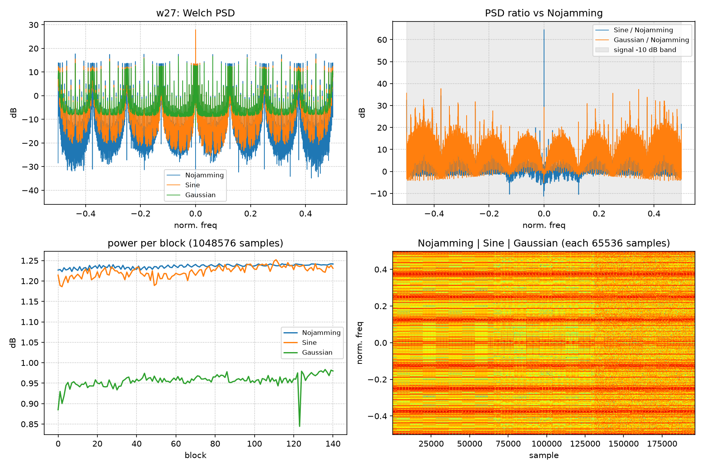
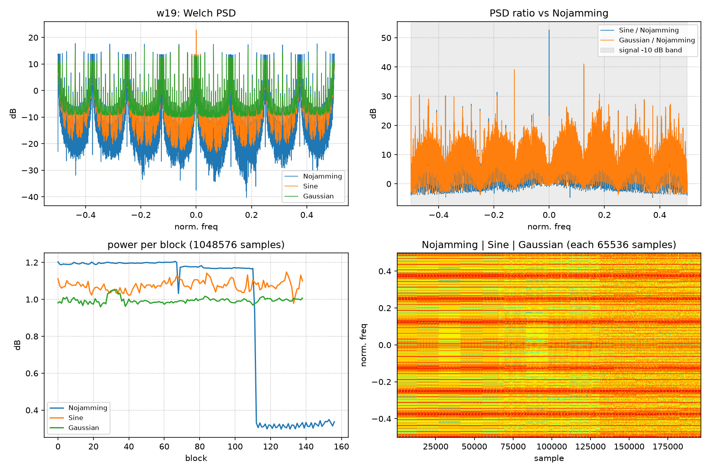
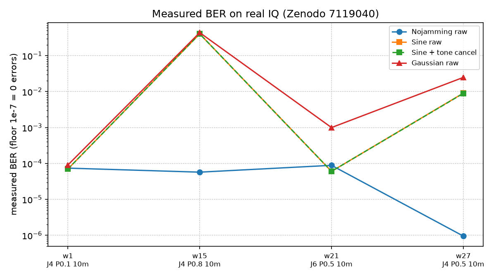
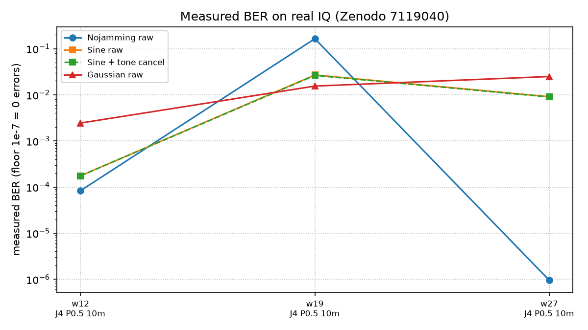

**실측 데이터로 학습한 재밍 분류기** (`real_detect.py`)

같은 데이터로 재밍 없음 / 톤 / 잡음을 구분하는 분류기를 학습했습니다. 판정에는 비트열 정보를 쓰지 않습니다. 같은 녹화의 구간끼리는 서로 비슷해서 섞어 나누면 정확도가 부풀려지므로, 녹화 파일 하나를 통째로 테스트로 빼고 나머지 다섯 개로 학습하는 방식(leave-one-file-out)을 6개 파일 모두에 반복했습니다. w19 재밍 없음의 장애 구간은 제외했습니다.

| 방법 | 입력 |
|---|---|
| 수신 전력 | 구간 평균 전력의 임계값 (재밍 유무만 판정) |
| 신호처리 특징 + 로지스틱 회귀 | 로그 전력, M2M4 블라인드 SNR 추정, 스펙트럼 평탄도, 최대 피크 대 두 번째 피크 비, DC 부근 피크 비 |
| CNN | 6.1과 같은 구조(`JammingCNN`, 3클래스)를 실측 스펙트로그램(32×32, 양측 대역)으로 재학습, 시드 2 |

**구간 4096심볼, CNN 프레임 64심볼** (파일당 1920구간)

| 테스트 파일 | 수신 전력 (유무 판정) | 특징 + 로지스틱 (3클래스) | CNN (3클래스) | CNN 클래스별 (없음 / 톤 / 잡음) |
|---|---|---|---|---|
| w1 (4번, 0.1) | 0.501 | 0.333 | 0.426 ± 0.024 | 0.39 / 0.44 / 0.45 |
| w12 (4번, 0.5) | 0.755 | 0.999 | 0.556 ± 0.070 | 0.26 / 0.46 / 0.95 |
| w15 (4번, 0.8) | 0.999 | 0.999 | 0.678 ± 0.010 | 0.24 / 0.80 / 1.00 |
| w19 (4번, 0.5) | 0.590 | 0.999 | 0.672 ± 0.020 | 0.13 / 0.90 / 0.99 |
| w21 (**6번**, 0.5) | 0.607 | 0.986 | 0.359 ± 0.006 | 0.08 / 0.00 / 1.00 |
| w27 (4번, 0.5) | 0.805 | 0.999 | 0.521 ± 0.126 | 0.14 / 0.43 / 1.00 |

**구간 32768심볼, CNN 프레임 2048심볼** (파일당 960구간, 그래프 값)

| 테스트 파일 | 수신 전력 (유무 판정) | 특징 + 로지스틱 (3클래스) | CNN (3클래스) |
|---|---|---|---|
| w1 (4번, 0.1) | 0.50 | 0.63 | 0.34 |
| w12 (4번, 0.5) | 0.74 | 1.00 | 0.77 |
| w15 (4번, 0.8) | 1.00 | 0.97 | 0.79 |
| w19 (4번, 0.5) | 0.57 | 1.00 | 0.94 |
| w21 (**6번**, 0.5) | 0.62 | 1.00 | 0.83 |
| w27 (4번, 0.5) | 0.76 | 1.00 | 0.83 |

- **신호처리 특징은 처음 보는 녹화와 장비로 일반화됩니다.** 학습에 없던 재머 장비 6번(w21)에서 98.6~100%, 같은 조건의 다른 녹화에서 99.9~100%입니다.
- **수신 전력은 쓸 수 없습니다.** 수신기 AGC 때문에 가장 강한 재밍(w15)만 구분하고, 나머지는 0.50~0.81입니다.
- **CNN은 짧은 프레임에서 실패했고, 원인은 입력 설계였습니다.** 짧은 프레임 CNN은 재밍 없음을 톤으로 잘못 판정했습니다(재밍 없음 정확도 0.08~0.39). 송신 데이터가 0~255를 세는 바이트라 64심볼 프레임에서는 위쪽 비트가 한동안 같은 값으로 유지되고, 프레임마다 DC 성분이 ±10 dB씩 달라져 DC 위치의 톤과 구분되지 않습니다. 합성 신호로 확인하면 64심볼 프레임에서 재밍 없음과 톤의 DC 대 평균 전력비 중앙값이 둘 다 −4.9 dB이고, 비트열 한 주기인 2048심볼 프레임에서는 2.6 dB 대 6.6 dB로 갈립니다. 프레임을 2048심볼로 바꾸자 처음 보는 장비(w21)에서 0.36이 0.83으로, 다른 녹화(w19)에서 0.67이 0.94로 올랐습니다.
- **그래도 이 데이터 규모에서는 신호처리 특징이 CNN보다 낫습니다.** 학습 데이터가 녹화 5개뿐이고, 특징에는 BPSK의 성질(정포락선, 블라인드 SNR)이 직접 들어 있습니다. 시뮬레이션(6.1)에서 99%였던 CNN도 실제 신호에서는 입력의 시간-주파수 해상도를 신호 구조에 맞춰야 했습니다.
- **관측을 길게 하면 약한 재밍도 일부 보입니다.** 상대 전력 0.1(w1)은 BER에 영향이 없었고, 4096심볼 구간에서는 특징 분류기가 모두 '재밍 없음'으로 판정했습니다(0.333). 32768심볼 구간에서는 0.63으로 올라갑니다. 탐지 감도와 판정 지연 사이의 트레이드오프입니다.
- 6개 파일, 재머 장비 두 종류(4번, 6번)의 결과이며, 거리 변화(w24~w31)와 다른 장비(w22, w23)는 시험하지 않았습니다. 긴 구간 표는 `results/real_detect_lofo_w32k.json`에서 소수 셋째 자리까지 확인할 수 있습니다.

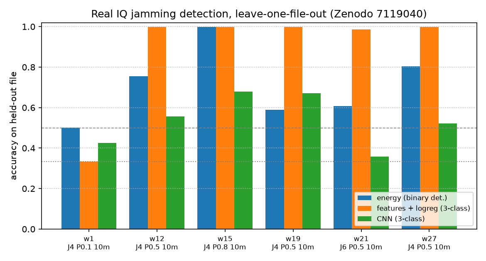
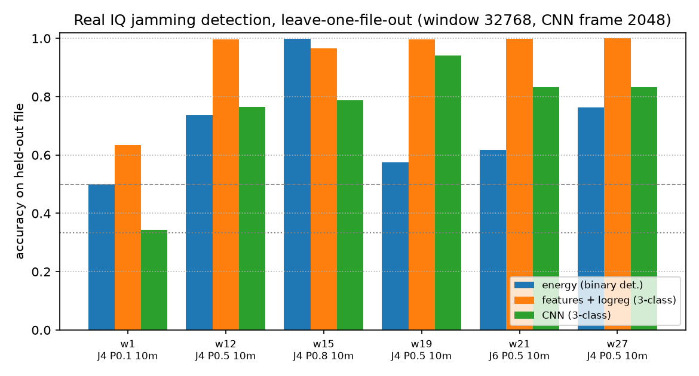

## 7. 한계

- 합성 신호와 단순화한 모델: 위성 채널은 6.11의 단순 모델(도플러, 링크 SNR, flat Rician 페이딩, 위상 잡음, 가정값)만 반영했고 전리층 신틸레이션, 강우 감쇠, 다중경로 지연 확산, 안테나 패턴, 하드웨어 영향이 없음. 채널 도약은 슬롯 단위의 추상 모델이며 도약 오버헤드와 송수신 동기화는 다루지 않음
- 위성 채널은 CNN 탐지(6.11)와 위성 통과 실험(6.13)에만 적용했고, 6.2~6.8의 DQN 실험은 AWGN 채널 기준. 통과 실험은 관측자 바로 위를 지나는 궤도 하나와 지연 0만 다룸
- CNN 정확도는 같은 시뮬레이터 안의 값이며 학습 범위 밖에서 하락. 6.16의 공개 실측 데이터는 심볼 단위로 저장되어 있어 시뮬레이션에서 학습한 CNN을 그대로 실측에 적용하지는 못했고(실측으로 다시 학습해 평가), SDR 검증도 하지 않았음. 에너지 검출기와의 비교는 AWGN 조건(6.14)에서만 함
- 6.16의 실측 BER은 기지 비트열로 동기를 맞춘 값(완벽한 파일럿 동기)이며, 지상 실내 환경 한 곳의 데이터임. 재머 상대 전력은 실제 J/S가 아님
- 이론 상한은 이 시뮬레이터의 재머 모델 안에서 정확한 값(6.12에서 검증)이며, 실제 재머에 대한 상한은 아님
- 핵심 결과(6.3, 6.5, 6.7의 일부)는 시드 5개, 나머지는 시드 1~3개. DQN과 표 기반 하이퍼파라미터는 튜닝하지 않았고, 최고 성능 시점의 모델을 저장하지 않아 정적 재머처럼 학습 후반이 흔들리는 경우 시드별 편차가 큼
- FEC 분석은 해석적 모델(한계거리 복호, 슬롯 내 독립 오류)이며 실제 부호기, 복호기 시뮬레이션이 아님
- 지연 시나리오의 슬롯 길이, 고각, 피드백 경로는 임의의 가정이며 특정 시스템의 값이 아님
- 추론 지연은 PC CPU 값으로 임베디드 성능을 대표하지 않음
- FHSS, AFH는 단순화한 구현이며, FHSS의 처리 이득과 도청 저확률 특성은 반영하지 않음
- 표 기반은 구성 가능한 설계만 비교함
- 지연 슬롯 수와 실제 LEO 궤도, 슬롯 길이의 대응은 확정하지 않음

## 8. 향후 계획

- 실측 분류기(6.16)를 다른 재머 장비(w22, w23)와 거리(w24~w31)로 확장하고, 신호처리 특징과 CNN을 결합한 모델 시험
- 동기 미끄러짐을 막는 수신 구조(동기 이전 단계의 간섭 제거)와 인터리빙을 실측 오류 패턴으로 평가
- 실제 위성 신호(GNSS) 공개 재밍 데이터(FGI Jammertest 2023)로 위성 환경 탐지 검증
- 위성 채널(페이딩)에서 에너지 검출기와 CNN의 대응 선택 성능 비교
- 처리 지연을 슬롯 길이 안으로 줄여 같은 슬롯 안에서 대응하는 구조(지연 없는 조회표가 가장 강함)
- 조회표와 무작위화를 결합한 방어(평소에는 조회표, 재머가 섞어 쓰는 기미가 보이면 혼합 전략)
- 최고 성능 시점 모델 저장 등 DQN 학습 안정화
- 절대 수신 전력 정보를 CNN 입력에 추가해 낮은 앙각의 오탐 감소
- FHSS, DSSS 등 전통 기법과의 물리계층 비교(처리 이득 관점)
- 시드 확대와 하이퍼파라미터 튜닝, 학습 범위 밖 J/S로 CNN 일반화 개선
