# 위성통신 AI 항재밍 채널 도약 시뮬레이션 (RF → STFT → CNN → DQN)

재밍 신호를 CNN으로 탐지하고, 그 탐지 결과(채널별 재밍 확률)만을 관측으로 삼아 강화학습(DQN)이 통신 채널을 고르는 항재밍 파이프라인의 시뮬레이션입니다. 재머의 위치(정답)는 보상 계산에만 쓰이고 에이전트의 관측으로 새지 않도록 설계했습니다.

> 공개된 일반 이론과 합성 신호만 사용한 학습용 시뮬레이션이며, 특정 무기체계나 실제 운용 정보와 무관합니다.

## 1. 한눈에 보기

- 4종 재머(단일톤, 스윕, 광대역 잡음, 부분대역 잡음)를 STFT 스펙트로그램 기반 2D-CNN으로 분류: 테스트 정확도 **99.0%** (SNR 0~20 dB, J/S 0~15 dB 범위, 합성 데이터)
- CNN 관측 기반 DQN 채널 도약: 재머 4개가 동시에 공격하는 32채널 환경에서 통신 성공률 **96.3%** (랜덤 호핑 88.5%, 이론 상한 근사값 97.5%)
- 표 기반 Q-learning을 30000 에피소드까지 학습시켜도 94.3%에 머무름 (DQN은 800 에피소드). 약 38배 적은 학습으로 더 높은 성공률
- 관측 지연 0~4슬롯(위성 전파 지연 모사)에서 이론 상한 곡선과 평행하게 약 1.1~1.5%p 아래 유지
- BPSK BER 시뮬레이터를 이론식 Q(√(2Eb/N0))와 대조해 검증
- 도플러, 링크 SNR, Rician 페이딩을 넣은 LEO 위성 채널(가정값)에서 CNN 탐지를 앙각별로 평가: 앙각 10도에서 오탐 18%로 증가, 채널 증강 재학습으로 11%까지 감소

## 2. 시스템 구조

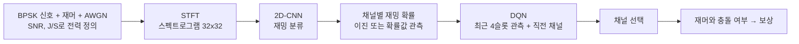

## 3. 파일 구성

| 파일 | 역할 |
|---|---|
| `signal_gen.py` | BPSK, 재머 4종 합성, SNR/J/S 기준 전력 설정, STFT 스펙트로그램 |
| `make_dataset.py` | CNN 학습/검증/테스트 데이터셋과 J/S, SNR 곡선용 고정 조건 세트 생성 |
| `train_cnn.py`, `eval_cnn.py` | CNN 정의, 학습, 혼동행렬, J/S·SNR별 정확도 곡선 |
| `env.py` | 채널 도약 환경(재머 5종, 관측 지연, 이진/확률 관측), CNN 출력 은행 |
| `dqn.py` | Double DQN, 표 기반 Q-learning |
| `run_e2e.py` | 실험 실행: `compare`, `sweep`, `history`, `delay`, `baselines`, `scenario` |
| `fec_eval.py` | 오류정정부호(BCH) 적용 시 프레임 오류율과 슬롯당 정보량 해석 |
| `deploy_bench.py` | 모델 크기, 연산량, CPU 추론 지연 측정, ONNX 내보내기 |
| `ber_eval.py` | BER 이론 검증, 재머 종류별 BER, 링크 BER 환산 |
| `channel.py` | 위성 채널 모델: 궤도 기하, 도플러, 링크 버짓 SNR, Rician 페이딩, 위상 잡음 |
| `realistic_eval.py` | 위성 채널에서 앙각별 CNN 탐지 평가, 채널 증강 데이터 생성 |

## 4. 실행 방법

```
pip install numpy scipy matplotlib torch
# ONNX 내보내기(deploy_bench.py --onnx)를 쓰려면 추가로: pip install onnx onnxscript
python make_dataset.py
python train_cnn.py
python eval_cnn.py
python run_e2e.py compare --jammer multi --n-jammers 4 --channels 32 --jsr 8 --obs-quant binary --episodes 800 --table-episodes 30000 --seeds 2 --out-tag final
python run_e2e.py history --jammer sequential --channels 8 --snr 5 --jsr -5 --obs-quant binary --histories 1 2 4 8 --episodes 300 --table-episodes 3000 --seeds 3 --out-tag h1248
python run_e2e.py delay --jammer multi --n-jammers 4 --channels 32 --jsr 8 --obs-quant binary --delays 0 2 4 --episodes 800 --seeds 2
python run_e2e.py baselines --channels 32 --n-jammers 4 --jsr 8 --obs-quant binary --seeds 3 --ref-compare compare_multi4_c32_h4_d0_bin_final.json
python run_e2e.py scenario --jammer multi --n-jammers 4 --channels 32 --jsr 8 --obs-quant binary --episodes 800 --table-episodes 10000 --seeds 2 --scenarios leo550 leo1200 meo8000 geo --slot-ms 10 --elev 25 --feedback rtt --proc-ms 12.3
python deploy_bench.py --cnn-path cnn_best.pt --channels 32 --history 4 --onnx
python fec_eval.py --link ber_link_compare_multi4_c32_h4_d0_bin_final.json
python ber_eval.py validate
python ber_eval.py link --compare compare_multi4_c32_h4_d0_bin_final.json
python realistic_eval.py dataset --out dataset_ch.npz
python train_cnn.py --data dataset_ch.npz --out cnn_ch.pt
python realistic_eval.py detect --cnn-path cnn_best.pt --compare-cnn cnn_ch.pt --out-tag leo550_aug
```

## 5. 시뮬레이션 모델

**신호**: 샘플링 2 kHz, 관측 0.5 s, 심볼률 100 baud(심볼당 20샘플)의 BPSK. 반송파 주파수와 위상은 샘플마다 무작위. SNR은 신호 전력 대 잡음 전력, J/S는 재머 전력 대 신호 전력(dB)으로 정의하고 신호 전력 기준으로 스케일링.

**재머**: 단일톤(주파수 무작위), 스윕(대역, 주기, 방향 무작위), 광대역 잡음, 부분대역 잡음. 모든 파라미터를 샘플마다 무작위화하여 CNN이 특정 값이 아니라 형태를 학습하도록 함.

**환경**: 에피소드당 100슬롯, 슬롯마다 에이전트가 채널 선택 후 재머가 이동, 충돌이면 보상 -1, 아니면 +1.

| 재머 모델 | 동작 |
|---|---|
| sequential | 확률 0.8로 다음 채널로 이동, 아니면 무작위 도약 |
| random | 매 슬롯 무작위 |
| reactive | 에이전트의 직전 채널을 확률 0.7로 추적 |
| permutation | 고정된 임의 순환 순서로 이동 |
| multi | n개의 독립 순차형 재머가 동시에 서로 다른 위치를 공격 |

**관측**: CNN이 낸 채널별 재밍 확률. `binary`는 0.5 임계로 이진 판정한 결과만 전달해 탐지 오류가 그대로 의사결정에 반영됨. 관측 지연 d슬롯은 센싱 결과가 d슬롯 늦게 도착하는 상황(위성 전파 지연 모사).

**이론 상한(근사)**: 재머의 무작위 도약 때문에 피할 수 없는 피격만 센다. 재머가 하나일 때 성공률은 $1-\frac{1-p^{d+1}}{C}$ (p는 규칙대로 이동할 확률 0.8, C는 채널 수, d는 관측 지연). 재머 n개가 서로 독립이라고 가정하면 $\left(1-\frac{1-p^{d+1}}{C}\right)^n$. 재머 간 겹침과 안전 채널 부족은 무시한 근사.

**DQN**: Double DQN, 상태는 최근 4슬롯 관측과 직전 채널(one-hot), 은닉층 128, 학습률 1e-3, 할인율 0.9, 탐험률 선형 감소.

**비교 baseline**: 고정 채널, 랜덤 호핑, FHSS(공유 의사난수 패턴), 센싱 회피, AFH(최근 4슬롯 감지 채널 블랙리스트)(이상 학습 없음), 표 기반 Q-learning 4종(1스텝, 2스텝, 4스텝, 비트마스크), oracle DQN(재머 위치를 정확히 아는 상한).

## 6. 결과

### 6.1 CNN 재밍 분류
테스트 정확도 99.0% (정상 0.99, 단일톤 0.97, 스윕 1.00, 잡음 1.00). 학습 범위 밖(J/S -5 dB, SNR -5 dB)에서는 크게 하락: 광대역 잡음 재머가 정상으로, 정상 신호가 잡음 재밍으로 오분류됨.

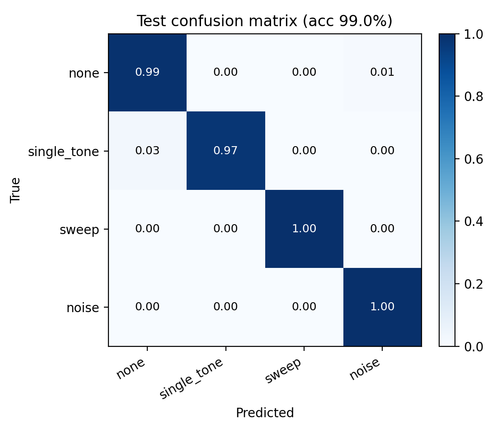
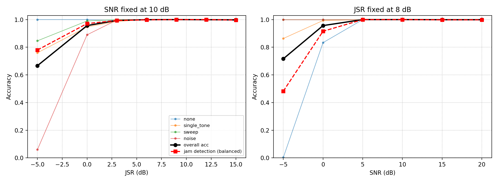

### 6.2 재머 종류별 (8채널, SNR 10 dB, J/S 8 dB, 시드 3, 300 에피소드, 확률값 관측)

| 재머 | 랜덤 호핑 | DQN(CNN 관측) | DQN(oracle) | Q-table |
|---|---|---|---|---|
| 순차형 | 87.8% | 97.5% | 97.6% | 97.4% |
| 반응형 | 87.5% | 95.6% | 95.7% | 96.2% |
| 순환 순서형 | 87.7% | 97.7% | 97.3% | 97.5% |

모두 이론 상한에 근접했고, 이 정도 규모에서는 표 기반도 동일한 성능이었음(DQN 우위 없음). 초기 실험 결과이며 원본은 `results/early/`에 있음. 이진 관측으로는 다시 돌리지 않았음.

### 6.3 다중 재머와 채널 수 확장 (이진 관측, J/S 8 dB)

| 환경 | 랜덤 | 최고 표 기반 | DQN(CNN) | 이론 상한(근사) |
|---|---|---|---|---|
| 재머 3, 8채널 | 66.9% | 92.3% (비트마스크) | 92.2% | 92.7% |
| 재머 3, 16채널 | 82.6% | 95.1% (비트마스크) | 95.8% | 96.3% |
| 재머 4, 32채널 | 88.5% | 94.3% (2스텝, 30000 에피소드) | 96.3% | 97.5% |

8채널은 400, 16채널은 600 에피소드, 시드 3개이며 원본은 `results/early/`에 있음. 8, 16채널의 표 기반은 DQN과 같은 학습 에피소드 수 조건. 32채널은 비트마스크 표(상태 2^32개)를 만들 수 없어 1스텝, 2스텝 표만 비교했고, 표를 5000 에피소드로 학습했을 때 92.5/93.1%, 30000 에피소드에서 94.0/94.3%였으며 약 15000 에피소드 이후 거의 평평해짐. DQN은 약 400 에피소드에 96~97%에 도달.

해석: 표 기반 상태는 4개 재머 중 하나의 위치만 요약하는 반면 DQN은 32채널 전체의 감지 벡터를 입력으로 받아 쓰므로, 격차(약 2%p)는 학습량이 아니라 상태 표현의 한계에서 오는 것으로 보임. 다만 다른 방식의 상태 압축 표(예: 감지된 채널 집합 요약)는 시험하지 않았음.

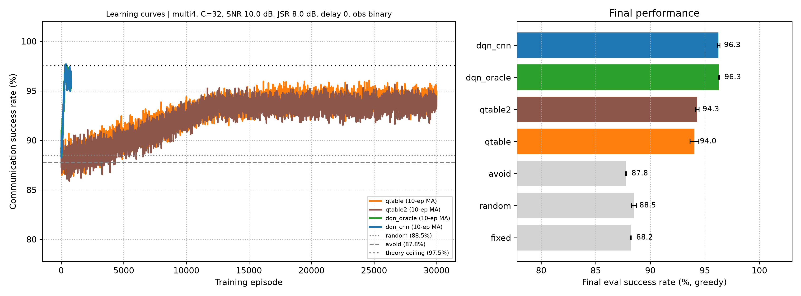

### 6.4 관측 이력 ablation (순차형, 이진 관측, SNR 5 dB, J/S -5 dB, 8채널)

| 이력 길이 | DQN(CNN 관측) |
|---|---|
| 1 | 92.1±0.8% |
| 2 | 94.0±0.3% |
| 4 | 94.9±0.3% |
| 8 | 94.9±0.1% |

oracle DQN은 이력과 무관하게 97.3~97.6%로 평평하므로, 이력은 재머 패턴 예측이 아니라 탐지 오류(미탐)를 메우는 데 쓰임. 표 기반을 3000 에피소드로 학습시키면 2스텝 94.7%, 4스텝 94.7%로 DQN(이력 4, 94.9±0.3%)과 구분되지 않음. 즉 8채널에서 DQN의 최종 성능 우위는 없고, 이득은 학습 속도와 채널 수 확장성에서 나옴.

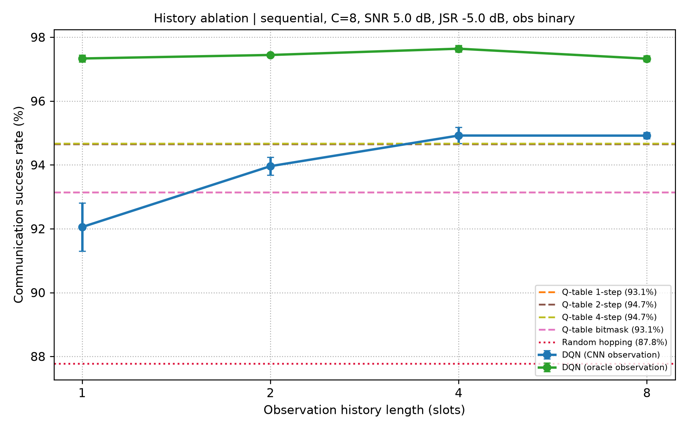

### 6.5 관측 지연 (재머 4개, 32채널, 이진 관측, J/S 8 dB, 시드 2)

| 지연(슬롯) | 랜덤 | Q-table 1스텝 | Q-table 2스텝 | DQN(oracle) | DQN(CNN) | 이론 상한(근사) |
|---|---|---|---|---|---|---|
| 0 | 88.5 | 90.9 | 90.1 | 96.3 | 96.3 | 97.5 |
| 2 | 88.5 | 90.0 | 89.8 | 92.6 | 92.9 | 94.0 |
| 4 | 88.5 | 88.6 | 88.9 | 90.7 | 90.4 | 91.9 |

DQN은 이론 상한과 평행하게 약 1.1~1.5%p 아래를 유지. 이 표의 표 기반은 800 에피소드 학습 조건이라 6.3처럼 더 오래 학습시키면 격차가 줄 수 있음.

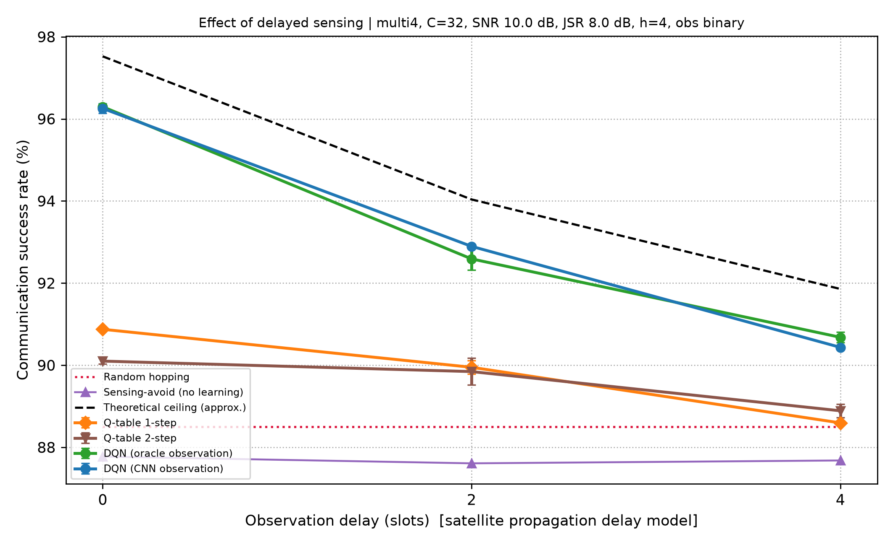

### 6.6 물리계층 BER 검증

- AWGN에서 BPSK BER 시뮬레이션이 이론식 $Q(\sqrt{2E_b/N_0})$와 일치(11개 점 중 10개는 1σ 이내이고, Eb/N0 6 dB 한 점은 시뮬레이션이 이론보다 약 15% 낮아 약 2.9σ 벗어남. 점이 11개라 우연일 수 있으나 재검증하지는 않음). 광대역 백색 재머가 있을 때도 SINR 기반 이론과 일치(최대 약 1σ).
- 재머 종류별: J/S가 낮을 때(0~6 dB)는 에너지가 집중되는 단일톤, 스윕, 부분대역 재머가 광대역 잡음보다 오류가 많고, J/S 9 dB 이상에서는 광대역 잡음이 가장 해로움.
- 링크 환산(32채널 다중 재머 4개, SNR 10 dB, J/S 8 dB): 재밍을 받은 슬롯의 BER은 약 4.6~6.6%로 사실상 손실이고, 평균 BER은 랜덤 호핑 약 5.3e-3, DQN(CNN) 약 1.7e-3 (재머 종류별로 약 3.1배 감소, 피격률 11.5% → 3.7%와 같은 비율). 정상 슬롯의 BER이 사실상 0이라 평균 BER은 피격률과 피격 슬롯 BER의 곱이며, 채널 부호화나 재전송 없이는 신뢰 통신 수준이 아님.

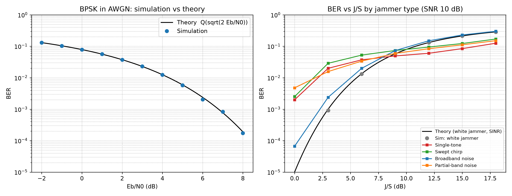
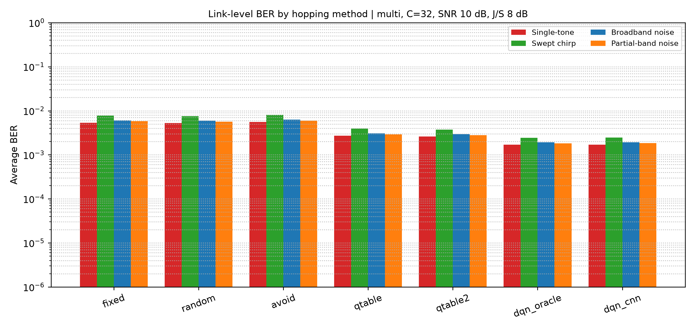

### 6.7 전통 기법(FHSS, AFH)과의 비교 (32채널, 이진 관측, J/S 8 dB, 시드 3)

| 재머 | 고정 | 랜덤 | FHSS | 센싱 회피 | AFH | 이론 상한(근사) |
|---|---|---|---|---|---|---|
| 순차형(1개) | 97.0 | 96.8 | 96.9 | 97.0 | 96.7 | 99.4 |
| 무작위 | 96.9 | 97.0 | 97.1 | 96.7 | 96.7 | 96.9 |
| 반응형 | 29.7 | 96.9 | 99.1 | 97.0 | 96.7 | 99.1 |
| 순환 순서형 | 96.9 | 96.9 | 96.8 | 96.9 | 96.8 | 99.4 |
| 다중 재머 4개 | 88.2 | 88.4 | 88.1 | 87.7 | 86.9 | 97.5 |

다중 재머 4개 환경에서 같은 조건의 학습 방법: 표 기반 94.0(1스텝), 94.3(2스텝), DQN(CNN) 96.3.

- 재머가 1개이고 채널이 32개면 무엇을 써도 약 97%라서 방법을 구분하지 못합니다. 이 시나리오는 변별력이 없고, 재머가 여러 개일 때 차이가 드러납니다.
- 재머 4개에서 학습이 없는 방법은 모두 88% 안팎에 머뭅니다. FHSS는 패턴을 모르는 재머에 대해 랜덤 호핑과 통계적으로 같고, 센싱 회피는 이득이 없으며, AFH는 랜덤보다 약 1.5%p 낮습니다. 이 환경의 재머는 매 슬롯 한 칸씩 이동하므로, 방금 감지된 채널을 피하거나 블랙리스트에 올리는 것은 재머가 이미 떠난 채널을 피하는 셈이기 때문으로 해석됩니다. 학습 기반 방법은 이 이동 규칙을 암묵적으로 이용해 6~8%p 높습니다(이 해석은 이론 상한식과 일치하는 정황이며 별도 실험으로 검증하지는 않았습니다).
- 반응형 재머에서 FHSS가 랜덤보다 높은 것은 이 모델의 재머가 에이전트의 직전 채널을 따라가고 FHSS 패턴은 같은 채널을 연속으로 쓰지 않기 때문입니다. 실제 시스템에서 FHSS가 우월하다는 증거로 해석하면 안 됩니다.
- FHSS 패턴을 아는 재머, 오래 머무르는 정적 재머(AFH가 원래 설계된 상황), FHSS의 처리 이득과 도청 저확률 특성은 이 시뮬레이션에 반영하지 않았습니다.

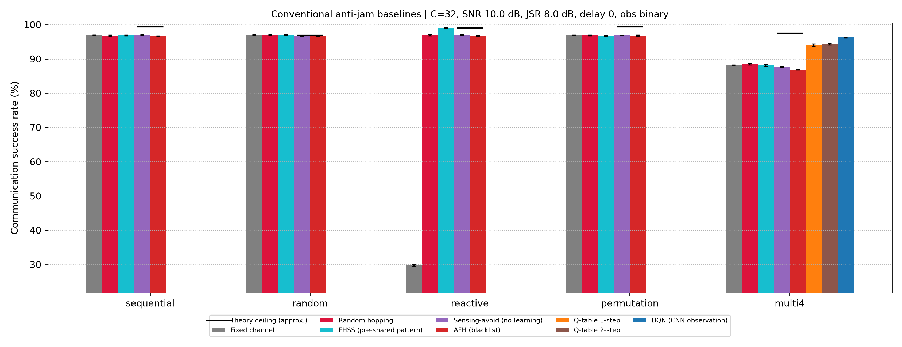

### 6.8 궤도별 관측 지연 시나리오 (32채널, 재머 4개, 이진 관측, J/S 8 dB, 시드 2)

고각 25도, 왕복 피드백, 슬롯 10 ms, 센싱 처리 지연 12.3 ms를 가정하고, 관측 지연을 d = ceil(경로 지연 / 슬롯 길이)로 환산했습니다. 궤도 고도는 공개된 대표값입니다.

| 시나리오 | 사거리(km) | 경로 지연(ms) | 지연 d | 랜덤 | 표 1스텝 | 표 2스텝 | DQN(CNN) | 이론 상한(근사) |
|---|---|---|---|---|---|---|---|---|
| LEO 550km | 1123 | 19.8 | 2 | 88.5 | 90.4 | 90.8 | 92.9 | 94.0 |
| LEO 1200km | 2204 | 27.0 | 3 | 88.5 | 90.2 | 89.8 | 91.2 | 92.8 |
| MEO 8063km | 10536 | 82.6 | 9 | 88.5 | 88.1 | 88.2 | 88.4 | 89.3 |
| GEO 35786km | 39067 | 272.9 | 28 | 88.5 | 88.0 | 88.3 | 88.2 | 88.1 |

- LEO에서는 학습 방법이 랜덤 호핑보다 약 2.7~4.4%p 높고 DQN이 표 기반보다 높습니다. MEO 이상에서는 모든 방법이 랜덤 호핑 수준으로 수렴합니다. 슬롯이 전파 지연보다 훨씬 짧으면 폐루프 센싱으로는 이득을 볼 수 없다는 뜻이며, 이 경우에는 예측형이나 개루프 방식이 필요합니다.
- 결과는 가정값(슬롯 길이, 고각, 왕복 피드백)에 크게 의존합니다. 슬롯을 길게 잡으면 같은 궤도에서도 d가 작아집니다.
- GEO에서 이론 상한(88.1)이 랜덤(88.5)보다 낮게 나오는 것은 상한식이 재머 간 겹침을 무시한 근사이기 때문이며, 엄밀한 상한이 아닙니다.
- 처리 지연을 측정값(13.7 ms) 대신 12.3 ms로 넣었습니다. 13.7 ms를 쓰면 LEO 550km의 d는 3이 되어 DQN 91.2%에 해당합니다.

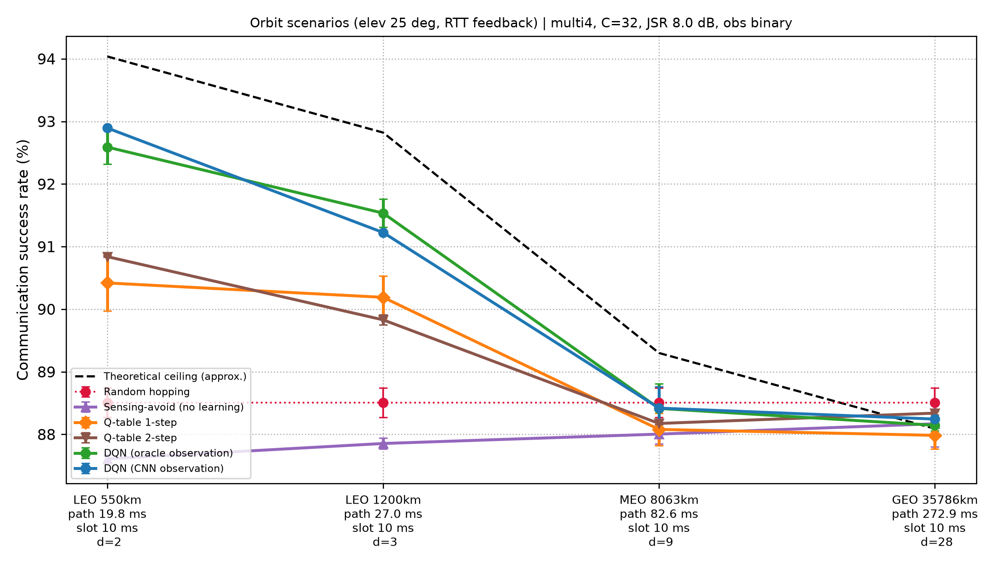

### 6.9 모델 크기와 추론 지연 (PC CPU 1스레드, PyTorch 2.15)

| 항목 | 값 |
|---|---|
| CNN | 파라미터 89,380개, FP32 349 kB, 채널당 2.57 M MACs |
| DQN (32채널, 이력 4) | 파라미터 41,248개, FP32 161 kB, 41.0 k MACs |
| STFT 1채널 | 0.17 ms |
| CNN 1채널 / 32채널 배치 | 0.32 ms / 7.7 ms |
| DQN 한 번 | 0.02 ms |
| 한 슬롯 전체(STFT 32채널 + CNN + DQN) | 13.7 ms (95퍼센타일 15.8 ms) |

- 두 모델 합쳐 약 510 kB(FP32)라 임베디드에 올리기에 작은 편입니다.
- 한 슬롯 처리 시간(13.7 ms)이 6.8의 슬롯 길이(10 ms)보다 깁니다. 이 PC에서 1스레드로는 10 ms 슬롯을 실시간으로 처리하지 못하며, STFT 일괄 처리나 GPU, FPGA 이식이 필요합니다. 임베디드 실측이 아니라 PC 값입니다.

### 6.10 오류정정부호(FEC)와 프레임 오류율 (해석적 모델)

슬롯 하나에 부호어(프레임) 하나를 싣고, 피격된 슬롯의 모든 비트가 6.6의 피격 슬롯 BER(4.6~6.6%)로 깨진다고 가정했습니다. 부호는 한계거리 복호(t개까지 정정)의 BCH로 두고 실제 부호기, 복호기는 구현하지 않았습니다. 피격률은 32채널 재머 4개 비교(6.3)의 값입니다.

프레임 오류율(%), 광대역 잡음 재머:

| 방법 | 부호 없음(k=64) | BCH(63,36,t=5) | BCH(127,64,t=10) | BCH(255,131,t=18) |
|---|---|---|---|---|
| 랜덤 호핑 | 11.1 | 1.22 | 0.75 | 0.82 |
| 표 기반 2스텝 | 5.5 | 0.61 | 0.37 | 0.41 |
| DQN(CNN) | 3.6 | 0.40 | 0.24 | 0.27 |

- 프레임 오류율은 피격률에 비례해서, 어떤 부호를 쓰든 DQN은 랜덤 호핑 대비 약 3.1배 낮습니다. 부호와 채널 선택의 효과는 곱으로 쌓입니다. 랜덤+부호 없음(11.1%)에서 DQN+BCH(127,64)(0.24%)까지 약 46배 감소하고, 스윕 재머처럼 BER이 높은 경우(11.3% → 0.80%)에는 약 14배입니다.
- 부호화의 대가는 정보량입니다. 재전송 없이 슬롯당 전달되는 정보량은 부호 없음 DQN이 약 0.96, BCH(127,64)는 약 0.50입니다. 피격이 드문 환경에서는 부호 없이 재전송(ARQ)을 쓰는 편이 평균 처리량은 높고, 부호는 재전송이 비싼 경우(왕복 지연이 긴 위성 링크 등)에 첫 전송의 신뢰도를 높이는 용도입니다.
- 스윕 재머(피격 슬롯 BER 6.6%)에서는 가장 긴 BCH(255,131,t=18)가 BCH(127,64,t=10)보다 프레임 오류율이 높습니다. 정정 가능 비율(t/n 약 7.1%)이 BER(6.6%)에 너무 가까워 오류 개수 분포의 꼬리에 걸리기 때문입니다. 즉 코드율을 더 낮춰야 합니다.
- FER 0.1% 이하를 만족하는 데 필요한 최소 정정 능력(n=127)은 랜덤 호핑 12~16, DQN 11~14로, 채널 선택이 부호 설계 요구를 1~2 정도만 낮춥니다.
- 가정: 슬롯 안에서 오류가 독립(인터리빙 가정), 부호화 비트당 에너지 불변, 재머 종류별 BER은 6.6의 값. 실제 재머의 오류는 슬롯 안에서 몰릴 수 있습니다.

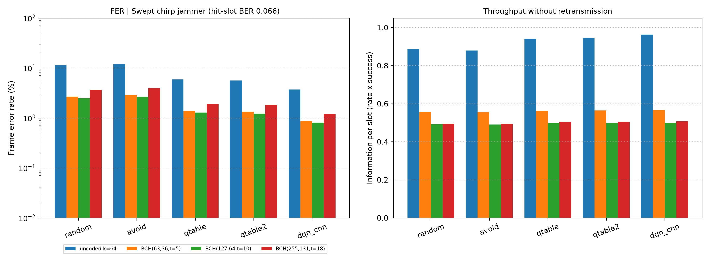

### 6.11 위성 채널에서의 재밍 탐지 (LEO 550 km, J/S 8 dB, 클래스당 300장, 시드 1)

6.1의 CNN은 AWGN과 재머만 있는 데이터로 학습했습니다. 여기서는 `channel.py`로 앙각에 따라 변하는 위성 채널을 더해 같은 CNN의 탐지 성능을 보고, 채널을 넣은 데이터로 다시 학습한 CNN(채널 증강)과 비교했습니다. 아래 수치는 모두 가정값이며 특정 실제 시스템의 사양이 아닙니다.

| 항목 | 가정값 |
|---|---|
| 궤도 | 원궤도 550 km, 관측자 바로 위를 지나는 통과, 지구 자전 무시 |
| 반송파, 심볼률 | 2.2 GHz, 100 ksps |
| 링크 SNR | 천정 15 dB 기준, 사거리에 따른 자유공간 손실 차이와 대기 손실(천정 0.2 dB, 1/sin(앙각)로 증가) 반영 |
| 페이딩 | 관측 구간 안에서 일정한 flat Rician, K 인수 3 dB(앙각 10도)에서 15 dB(90도)까지 선형 |
| 위상 잡음 | 샘플당 표준편차 0.005 rad의 랜덤워크 |
| 도플러 | 보상 없음. 시뮬레이션이 100 baud로 축소된 모델이라 심볼률 대비 비율(fd/Rs)로 환산해 적용 |
| 재머 | 지상 재머를 가정해 도플러와 페이딩을 받지 않음 |

균형 탐지 정확도(%)와 오탐률(FPR)입니다. 조건마다 한 요소씩 켰고, 링크 SNR은 모든 조건에서 앙각에 따라 변합니다.

| 앙각 | 링크 SNR (dB) | 도플러 (kHz) | AWGN만 | +도플러 | +페이딩 | 전부 | 전부, 증강 CNN | FPR 기존 → 증강 |
|---|---|---|---|---|---|---|---|---|
| 10° | 3.7 | 50.5 | 100.0 | 99.8 | 89.3 | 91.0 | 94.3 | 18.0% → 11.0% |
| 20° | 7.2 | 48.2 | 99.5 | 100.0 | 97.7 | 97.0 | 97.9 | 6.0% → 4.0% |
| 30° | 9.7 | 44.4 | 100.0 | 100.0 | 99.7 | 98.8 | 99.7 | 2.3% → 0.7% |
| 45° | 12.2 | 36.3 | 100.0 | 99.8 | 100.0 | 99.8 | 99.8 | 0.3% → 0.3% |
| 60° | 13.8 | 25.6 | 99.8 | 100.0 | 100.0 | 100.0 | 99.9 | 0.0% → 0.0% |
| 75° | 14.7 | 13.3 | 99.7 | 100.0 | 99.8 | 99.7 | 99.8 | 0.7% → 0.3% |
| 90° | 15.0 | 0.0 | 99.8 | 100.0 | 99.8 | 100.0 | 99.8 | 0.0% → 0.3% |

- 도플러만 넣었을 때는 성능 변화가 없습니다. CNN을 학습할 때 반송파 주파수를 무작위로 바꿨기 때문에, 이 가정(심볼률 100 ksps)에서의 도플러 이동은 학습 범위 안에 들어갑니다. 심볼률이 더 낮으면 fd/Rs가 커져 결과가 달라질 수 있습니다.
- 성능 저하의 주원인은 낮은 앙각의 페이딩입니다. 재밍을 놓치지는 않고(TPR은 모든 조건에서 99.7% 이상), 신호가 깊게 꺼진 정상 채널을 재밍으로 잘못 판정하는 오탐이 늘어납니다.
- 채널 증강 재학습(학습 데이터의 절반을 현실 채널 샘플로 교체, 학습과 평가 샘플은 다른 시드)으로 앙각 10도의 오탐이 18%에서 11%로 줄었습니다. AWGN 조건 정확도는 99.7~100%로 유지되어 깨끗한 조건의 성능을 잃지 않았습니다. 같은 평가 샘플에서 비교했고, 10도의 오탐 차이는 표본 오차의 약 2.5배입니다(시드 1개).
- 남은 오탐의 원인은 전처리로 추정합니다. 스펙트로그램을 샘플마다 표준화하므로 CNN은 절대 수신 전력을 볼 수 없고, 깊게 꺼진 신호는 표준화 후 광대역 잡음 재밍과 비슷해집니다. 이 가설은 검증하지 않았습니다. 수신 전력을 추가 입력으로 넣거나 여러 슬롯의 판정을 평균하는 방법이 다음 후보입니다.
- 앙각 20도 이상에서는 두 CNN 모두 97% 이상입니다. 운용 최저 앙각을 두는 것도 대안입니다.
- 이 오탐이 DQN 통신 성공률에 주는 영향은 평가하지 않았습니다. 6.3~6.8의 DQN 결과는 AWGN 채널의 CNN 출력으로 얻은 값입니다.

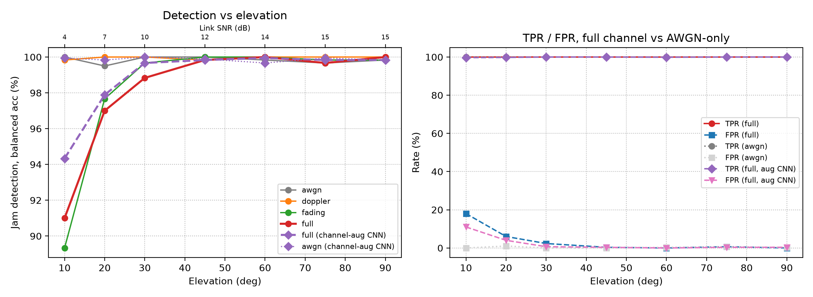

## 7. 한계

- 합성 신호와 단순화한 모델: 위성 채널은 6.11의 단순 모델(도플러, 링크 SNR, flat Rician 페이딩, 위상 잡음, 가정값)만 반영했고 전리층 신틸레이션, 강우 감쇠, 다중경로 지연 확산, 안테나 패턴, 하드웨어 영향이 없음. 채널 도약은 슬롯 단위의 추상 모델이며 도약 오버헤드와 송수신 동기화는 다루지 않음
- 위성 채널은 CNN 탐지 단계에만 적용했고, DQN 실험(6.2~6.8)은 AWGN 채널 기준
- CNN 정확도는 같은 시뮬레이터 안의 값이며 학습 범위 밖에서 하락. 실측 데이터나 SDR로 검증하지 않음
- 이론 상한은 재머 독립성 등을 가정한 근사식
- 시드 2~3개, DQN과 표 기반 하이퍼파라미터는 튜닝하지 않음
- FEC 분석은 해석적 모델(한계거리 복호, 슬롯 내 독립 오류)이며 실제 부호기, 복호기 시뮬레이션이 아님
- 지연 시나리오의 슬롯 길이, 고각, 피드백 경로는 임의의 가정이며 특정 시스템의 값이 아님
- 추론 지연은 PC CPU 값으로 임베디드 성능을 대표하지 않음
- FHSS, AFH는 단순화한 구현이며, 재머가 패턴을 아는 경우와 정적 재머는 평가하지 않음
- 표 기반은 구성 가능한 설계만 비교했고, 지연 실험의 표 기반은 충분히 학습시키지 않음
- 지연 슬롯 수와 실제 LEO 궤도, 슬롯 길이의 대응은 확정하지 않음

## 8. 향후 계획

- 위성 채널의 앙각별 탐지 결과를 DQN 평가에 연결(위성 한 번 통과 동안의 통신 성공률)
- 절대 수신 전력 정보를 CNN 입력에 추가해 낮은 앙각의 오탐 감소
- FHSS, DSSS 등 전통 기법과의 물리계층 비교(처리 이득 관점)
- 시드 확대와 하이퍼파라미터 튜닝, 학습 범위 밖 J/S로 CNN 일반화 개선
